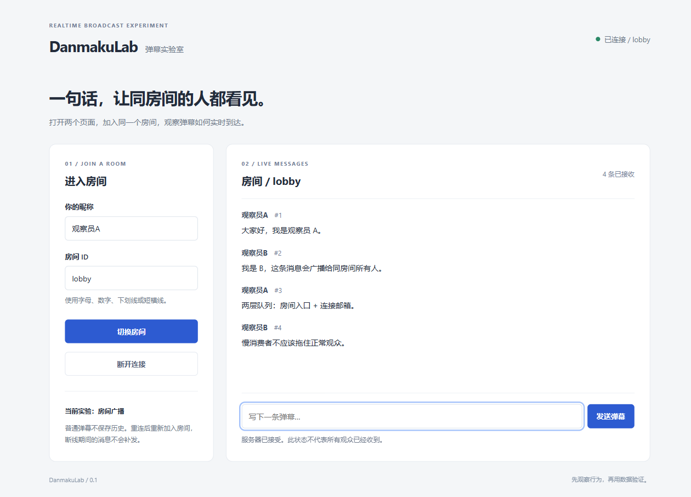

# DanmakuLab

[](LICENSE)
[](https://openjdk.org/projects/jdk/21/)
[](pom.xml)
[](docs/PROTOCOL.md)
[](docs/CLUSTER.md)
[](docs/BENCHMARK.md)

> **实时弹幕广播与背压实验：在 1000 连接下，验证“慢消费者不会拖垮正常观众”。**

一个面向 Java 后端学习与面试展示的作品集项目。它不只实现“发弹幕”，而是把广播扇出、慢消费者背压、热点房间隔离和性能验证做成可运行、可复现、可解释的实验。

**一句话数据：** 1000 连接下，T3/T5 六轮共 **1.6146 亿次**正常投递全收；T4 六轮共 **6926.7 万次**全收。

<p align="center">
  
</p>

<p align="center"><em>两个页面加入 <code>lobby</code> 后互发弹幕；右侧是客户端实际接收计数。</em></p>

## 项目概览

| 维度 | 内容 |
| --- | --- |
| 定位 | 实时弹幕广播 / 慢消费者隔离实验 |
| 技术栈 | Java 21、Spring Boot 3.5.16、原生 WebSocket、Micrometer、Redis Pub/Sub（可选）、JUnit、k6、Python asyncio |
| 验证规模 | 本机回环 1000 连接；T3 3×15 分钟、T5 3×30 分钟、T4 3 对 6 轮 |
| 工程重点 | 两级有界队列、异步输出、慢消费者隔离、热点房间调度、客户端实收对账 |
| 版本 | `v0.3.0.0`，`main` 分支，MIT License |

## 面试时怎么讲

**一句话：** 这是一个用真实客户端实收来验证 WebSocket 广播设计的项目；核心问题是“一条消息发给很多人时，怎样不让慢的人拖垮快的人”。

**三个技术点：**

1. **两层队列**：房间入口队列控制“待扇出的输入”，连接邮箱控制“某个观众待发的消息”，分别限制条数、字节和全局预算。
2. **异步输出**：共享提交线程只发起容器异步写，不在线程里等网络；每连接最多一条在途，完成回调后释放预算。
3. **可验证性**：`accepted`、`enqueued`、`submitted` 和客户端逐观众实收分开记录；完整率检查所有必达观众，不拿服务端计数冒充收到。

**一个取舍：** `fair` 调度提供有界入口和批次轮转，但三对 T4 没有证明它全面更快；我保留这个结论，而不是把“机制”写成“收益”。

## 技术难点与设计

### 1. 慢消费者为什么会拖住整个房间

同步 `direct` 路径在房间锁内逐个写网络。一个 TCP 接收窗口被填满的观众，会让发送线程停在 `write`，同房间其他发送者等待同一把锁。

Linux 诊断里用 `ss`、线程转储和异步指标把这条链路对上：探针 Send-Q 持续增长，`exec` 线程在 Tomcat 同步写中持有 `Room` 锁，另外 9 个线程等待同一把锁；同步停读组正常观众 P99 为 **4322 ms**。

### 2. 两级队列：把“输入积压”和“输出积压”分开

`buffered` 为每个连接维护独立 FIFO 邮箱，限制条数、字节和全局字节预算；普通弹幕超龄可淘汰，控制回复不能静默丢弃。`fair` 再把待扇出的输入放进有界房间队列，按就绪房间轮转。

两层都满时行为不同：房间入口可以拒绝新输入；连接邮箱可以淘汰过期弹幕，无法保留控制消息时关闭连接。这样，单个慢观众不会无限占用共享内存，热点输入也不会直接压到分发线程。

### 3. 异步写与完成回调

共享固定提交线程只发起容器异步写，网络等待不占线程；每连接最多一条在途，完成回调释放预算并激活下一条。20 连接、10 个慢读、20 条/s、20 秒窗口的对照中，旧同步发送池正常观众只收到 **1566/4000**，异步输出后为 **4000/4000**。

### 4. 热点房间与公平调度

`fair` 为每个房间和全局入口设置条数/字节预算，按批次轮转，避免一个热点房间长期占住分发线程。T4 用 direct/fair 三对六轮验证完整投递，但逐房间 P99 有快有慢，所以不宣称 fair 普遍更快。

### 5. Redis 双节点（可选）

每个 JVM 只持有自己的连接，广播事件通过 Redis Pub/Sub 传播；发布/接收都有有界队列，发布超时返回 `unknown` 且不自动重发。默认仍是 `local`；双节点是扩展能力，不是容量翻倍承诺。

## 实测结果

> 数字绑定 JAR、人数、模式、机器和测量窗口；完整条件和原始证据见 [性能报告](docs/performance-report.md)。

| 场景 | 结果 | 关键限制 |
| --- | --- | --- |
| [T3 ×3](docs/results/2026-10-28/longrun-repeat-02/notes.md) | 990 正常 + 初始 10 慢读，20 条/s，900 秒；3 轮合计 **5346 万次**全收，P99 **31/30/29 ms** | 慢组被关闭后不补建 |
| [T5 ×3](docs/results/2026-10-28/longrun-repeat-02/notes.md) | 1000 正常观众，20 条/s，1800 秒；3 轮合计 **1.08 亿次**全收，P99 **36/39/37 ms** | 每轮另有 60 秒预热 |
| [T4 ×6](docs/results/2026-10-27/t4-workers-formal-01/notes.md) | 1000 观众，四阶段；六轮合计 **6926.7 万次**全收，热点合并 P99 **6–7 ms**，普通单房最大 **27 ms** | 未证明 fair 全面更快 |
| [T2](docs/results/2026-10-26/t2-report.md) | 1000 观众，5/20/50/100 条/s；**3150 万次**全收，P99 **9/9/9/51 ms** | 显式房间额度 200/s |
| [T6](docs/results/2026-10-26/t6-report.md) | 100/500 人，一半断连重入；必达 **11 万/55 万次**，恢复 P99 **3–4/15–16 ms** | Python 模拟退避 |
| [Redis](docs/results/2026-10-26/redis-report.md) | 100/1000 观众，60 秒；**12 万/120 万次**，P99 **7/40 ms** | 首轮实网，不是 30 分钟稳态 |
| [Linux I/O](docs/results/2026-10-30/linux-io-01/notes.md) | 同步停读正常组 P99 **4322 ms**；异步停读 **36000/36000** 全收、P99 **7 ms** | 11 连接小规模机制诊断 |

**可以带走的结论：**

- 最明确的收益是把共享发送线程从同步网络等待中释放，而不是“线程越多越快”。
- `fair` 的价值是有界入口和可解释的轮转，不是在所有阶段都更快。
- Linux 组证明异步输出隔离了应用等待，但没有消除 TCP 背压；慢连接仍可能被降级或关闭。

**统计口径：**

- **实收**指客户端解析到真实 `danmaku` 后按消息身份去重；`accepted`/`submitted` 不能替代它。
- 完整率检查全部必达观众；P99 只对抽样连接计算，多轮/多房间保留原值，不先平均。
- 发送计划滞后与接收延迟分开记录，不相加。

## 架构与消息路径

```text
浏览器 / k6 / Python 客户端
        │  /ws 文本 JSON
        ▼
DanmakuHandler ── 帧大小 / 字段 / 成员关系 / 两级令牌桶
        │
        ▼
BroadcastIngress
        ├─ local ──► 房间分发：direct（锁内直发）或 fair（有界队列 + 批次轮转）
        └─ redis ──► 有界发布队列 ──► Redis Pub/Sub ──► 订阅回流 ──► 房间分发（fair）
        ▼
DirectBroadcaster：成员快照 + roomSeq + 只编码一次
        ▼
ClientConnection：direct 同步写 / buffered 邮箱 + 容器异步写
```

一条消息的关键阶段：

1. 校验完整帧、字段和成员关系，再通过连接/房间两级令牌桶。
2. `direct` 在房间锁内取快照、分配序号并逐个投递；`fair` 先进有界房间队列。
3. 广播只编码一次，然后按连接进入同步写或连接邮箱。
4. `buffered` 由共享提交线程发起容器异步写，完成回调释放预算。
5. 服务端计数和客户端实收分别记录，最后对账。

更细的代码阅读顺序见 [消息路径](docs/MESSAGE_PATH.md)，协议字段见 [PROTOCOL.md](docs/PROTOCOL.md)。

## 快速开始

需要 JDK 21+、Maven 3.9+。

```powershell
mvn -B -ntp verify
java -Xms128m -Xmx256m -jar target/danmaku-lab-0.1.0-SNAPSHOT.jar
```

打开 [http://127.0.0.1:8080/](http://127.0.0.1:8080/)，两个页面加入 `lobby` 即可互发弹幕。健康检查 `/actuator/health`；指标入口 `/actuator/metrics`。

一键演示（Windows / PowerShell 7）：

```powershell
pwsh -NoProfile -File scripts/run/quickstart.ps1 -Mode fair
```

更多启动模式、配置、Redis 双节点和压测步骤见 [五分钟演示](docs/demo-and-resume.md)、[架构](docs/ARCHITECTURE.md)、[压测规范](docs/BENCHMARK.md)。

## 项目结构

```text
src/main/java/.../protocol/   # /ws 入口：解析、校验、限流、路由
src/main/java/.../core/       # 连接/房间、广播、邮箱、fair 调度、令牌桶
src/main/java/.../cluster/    # 可选 Redis Pub/Sub 桥接
src/main/resources/static/    # 演示页：原生 HTML/CSS/JS
src/test/java/                # JUnit 与真实 WebSocket 集成测试
scripts/                      # k6 / Python 压测、采集、归档和 quickstart
docs/                         # 设计、协议、逐轮实验记录
```

## 文档与证据

| 想了解 | 入口 |
| --- | --- |
| 五分钟演示、源码讲解、简历草稿 | [demo-and-resume.md](docs/demo-and-resume.md) |
| 架构与消息语义 | [ARCHITECTURE.md](docs/ARCHITECTURE.md) / [MESSAGE_PATH.md](docs/MESSAGE_PATH.md) |
| 协议字段与拒绝原因 | [PROTOCOL.md](docs/PROTOCOL.md) |
| 性能结果与边界 | [performance-report.md](docs/performance-report.md) |
| 压测方法与逐轮记录 | [BENCHMARK.md](docs/BENCHMARK.md) / [results/](docs/results/) |
| 慢消费者与 Linux 诊断 | [ASYNC_OUTBOUND.md](docs/ASYNC_OUTBOUND.md) / [LINUX_IO.md](docs/LINUX_IO.md) |
| Redis 双节点 | [CLUSTER.md](docs/CLUSTER.md) |
| 发布检查与制品哈希 | [ship-verification](docs/results/2026-10-27/ship-verification/README.md) |

## 已知边界

- 没有账号、权限和普通弹幕历史；断线不补发，不承诺可靠交付或永久去重。
- 单房间内按 `roomSeq` 递增；Redis 模式保留来源节点流，跨来源不比较单一全局序号。
- 1000 连接不是最大容量；没有 5000/10000 连接、公网或独立压测机证据。
- 主力长测为 Windows 11 同机回环；Linux 只有 WSL2/JDK 21 的 11 连接诊断。
- `fair` 不是“必然更快”；T3 慢组关闭后不补建，结论限定在初始 1% 慢读。
- 数字绑定 JAR 和条件；引用时请带上 [性能报告](docs/performance-report.md) 的限制。

## 版本与状态

- 版本 `0.3.0.0`，已合入 `main` 并创建 tag `v0.3.0.0`；发布候选 JAR SHA-256 前缀 `BC565288…`。
- 82 项常规 Java 测试通过；另有真实 Redis 集成和 Python/Node 工具测试记录。
- 后续可补充：手工演示与发布前检查；千连接 Linux、Redis 30 分钟稳态、异机/公网属于扩展验证。
- 这是一个个人学习与作品展示项目，暂不接受外部功能 PR；问题反馈见 [GitHub Issues](https://github.com/Choco-emmm/DanmakuLab/issues)。

## License

[MIT License](LICENSE)

Copyright (c) 2026 Choco-emmm
