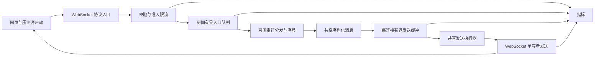

# 架构与消息语义草案

状态：2026-10-24 已保留 direct 基线并接入 buffered 连接邮箱、全局输出预算和过载清理；下文房间入口队列、房间公平调度和多实例仍为目标设计。当前输出实现见 [BOUNDED_OUTBOUND.md](BOUNDED_OUTBOUND.md)，已实现协议与边界见 [PROTOCOL.md](PROTOCOL.md)。

## 1. 需要验证的问题

1. 逐连接直接发送，在慢连接存在时是否使其他观众等待？影响多大？
2. 连接级有界缓冲能否保护内存，并降低正常观众的尾延迟？代价是什么？
3. 热点房间涌入消息后，限流和调度是否能保护其他房间？
4. 容量受到 CPU、网络、连接资源还是压测器限制？

不预设每次优化都会获益；结论以实验结果为准。

## 2. 单机消息路径

下图为完整目标路径；当前只实现直接分发与连接邮箱两种输出模式，房间入口队列和房间调度器尚未接入。

基线模式保留校验、准入和相同输入协议，使用直接广播。优化模式逐步加入队列和隔离。对照时尽量保持输入、消息大小、容器参数与资源预算相同，并明确记录不可避免的差异。

## 3. 模块与资源归属

| 模块 | 职责 | 必须控制的资源 |
| --- | --- | --- |
| 协议入口 | 解析、校验、房间加入、发送结果 | 单帧字节数、字段长度、连接数 |
| ConnectionRegistry | 管理连接和成员生命周期 | 每连接仅一个活动房间；断连清理 |
| RoomDispatcher | 准入后的排队、序号和扇出 | 房间数、房间入口字节/条数、每次调度批量 |
| OutboundMailbox | 缓存尚未交给传输层的消息 | 字节数、条数、最老消息年龄与全局缓冲预算 |
| SendScheduler | 调度连接发送，避免并发写 | 工作线程数、待执行任务数、每连接单次激活 |
| Metrics | 记录接受、拒绝、丢弃、发送和资源 | 标签基数，不以用户或消息 ID 作为指标标签 |

上表包含目标模块名称：当前房间分发由 `DirectBroadcaster` 完成，`RoomDispatcher` 尚未实现；连接发送调度、全局预算与关闭池由 `OutboundService` 管理，尚无独立的 `SendScheduler` 类。当前邮箱预算包含控制回复、普通弹幕和已取出但写入尚未返回的在途条目。

不为每个连接或每个房间创建专属线程，不为每条投递无界创建线程池任务。共享执行器必须有界，拒绝执行时有明确处理和指标；不得阻塞 WebSocket 接收线程无限等待。

同房间同一时刻仅一个分发者推进队列；可以采用固定数量的分片调度器或共享执行器加单次激活标志。按批次交还执行权，避免热点无限独占。共享资源仍可能引入干扰，因此隔离效果必须通过普通房间的延迟数据验证。

## 4. 初始协议边界

- 初版每条连接最多加入一个房间；换房先检查目标容量，通过后再移除旧成员关系，拒绝时保留原房间。房间 ID 和显示昵称有长度限制。
- 客户端文本帧至少区分 `join`、`send`、应用层心跳；服务端区分加入结果、发送结果、弹幕和错误。
- `send` 携带唯一 `clientMessageId`，用于测量与诊断；本轮不承诺跨重连去重。
- `accepted` 表示服务器已通过输入准入；当前 direct 与 buffered 均无房间入口队列，分别直接发送或投递连接邮箱。将来房间入口队列落地时需单独更新接纳语义，当前不表示所有观众已收到或输出均已入队。
- `rejected` 带稳定原因，例如非法消息、未加入房间、限流或入口满。
- 对外演示无完整账号系统；昵称只是显示字段，服务端生成连接身份，不把客户端身份字段视作认证。
- 仅展示文本，浏览器通过安全文本 API 渲染，避免把弹幕当 HTML 插入。

## 5. 顺序与交付语义

- 当前 direct 与 buffered 均以取得房间分发锁的顺序生成递增 `roomSeq`；目标房间入口队列落地后再以其接纳顺序分发。不以不同客户端的本地发送时间决定全局先后。
- 不主动丢弃且连接持续正常时，房间广播队列保持该连接看到的 `roomSeq` 递增。
- 连接降级会出现序号缺口；序号缺口不等于乱序。连接中途加入也会自然缺少更早的序号。
- 成员快照在分发时确定。计数、正常退出和断连清理需要围绕这个边界统一，避免把未加入的用户算作丢失。
- 普通弹幕允许因明确降级或连接故障丢失，不做历史补发，不宣称可靠交付或 exactly-once。
- 当前基线在房间锁内分配序号；优化模式将以入口队列接纳顺序分发。进程重启或空房间删除重建可重置序号，使用 `runId + roomInstanceId + roomSeq` 解释唯一范围；跨节点扩展不承诺全局严格顺序。

## 6. 慢消费者处理

初始可配置实验参数，而非提前承诺的最佳值：

| 约束 | 初始值 | 验证点 |
| --- | --- | --- |
| 最大输入帧 | 1 KiB | 包含完整 UTF-8 JSON；超限拒绝或关闭 |
| 每连接输出预算 | 64 KiB 或 256 条，先到者生效 | 包含控制回复、普通弹幕及在途条目；按 UTF-8 字节计数，单条消息不能突破上限 |
| 待发消息最长年龄 | 1 秒 | 清理过期但尚未写入传输层的弹幕 |
| 全局应用待发缓冲 | 128 MiB | 与每连接上限共同生效；分配和释放计数一致 |
| 房间入口 | 1,024 条且 1 MiB | 超限拒绝新输入，不转移到无界执行器排队 |
| 每连接输入速率 | 5 条/秒，允许小幅突发 | 压测使用足够发送者，避免把限流误认为容量瓶颈 |
| 房间输入速率 | 初始 50 条/秒，可按实验调整 | 高速压测必须显式调整并归档 |

优先丢弃尚在应用队列中的旧普通弹幕，尽量保留新内容；持续无法发送或超过超时阈值则关闭慢连接。具体持续时间首轮实验后确定。

关键实现约束：

- 弹幕、业务回应和心跳必须遵守统一的单连接写入策略，不能仅给弹幕发送加锁。
- 控制消息与普通弹幕的处理需明确；控制消息不得被静默当作旧弹幕丢掉，也不能绕过总缓冲预算。控制消息无法及时发送时关闭连接。
- 已进入 WebSocket 容器、TLS、内核发送缓冲的数据，不能靠删除应用队列撤回。若客户端持续无法消化已提交数据，断连是必要兜底。
- 应用缓冲有界不等于整个进程内存有界；容器缓冲、执行器队列、线程栈及内核 socket 内存也要观测。
- 断连需要移除房间成员、注销连接、取消待发送状态，并释放应用缓冲计数。
- 异步发送完成/失败回调与关闭可能并发，释放和调度必须幂等，不能出现重复发送者或负数预算。

Spring 官方指出底层标准 WebSocket session 不允许并发发送；框架装饰器可作为基础保护，但不能替代本项目需要验证的丢弃、队列预算和调度策略。

## 7. 热点隔离

- 输入侧限制单连接和单房间速率；房间入口满时明确拒绝。
- 调度侧限制一次处理的消息/连接批量，避免一个热点任务一直占用工作线程。
- 输出侧限制连接与全局缓冲；工作池饱和时采取明确降级，记录原因。
- 对照实验固定普通房间负载，只提高热点房间负载，观察普通房间 P95/P99 和拒绝情况。
- 房间级隔离只限制部分共享资源竞争，不能承诺在共享 CPU/带宽被耗尽时完全互不影响。

## 8. P1 双实例方案

先完成单机 P0，再增加：入口节点验证后发布 Redis；所有订阅节点根据本地房间成员广播，包括入口节点。入口节点不再额外走一遍本地直发，避免重复投递。

明确 `originNodeId`、`messageId` 与本地接收路径；验证发布失败、订阅断开、重复本地投递和实例退出。首版可使用单一广播频道简化路由，热点与频道细分留作后续研究；报告跨节点带宽成本。

Redis Pub/Sub 不保留断线期间消息。双实例演示只证明跨节点传播和重连行为，不自动证明吞吐量线性增长，也不承诺跨发布者的全局严格顺序。

## 9. 关键测试

- 同房间收发与跨房间隔离，未加入房间和非法输入。
- 两个发送者并发时序号递增；成员加入/退出与广播并发时生命周期正确。
- 缓冲字节与条数恰好到边界、单条超限、过期清理、全局预算耗尽。
- 每连接发送无并发写；队列变空和新入队同时发生时不会漏唤醒。
- 发送失败、执行器拒绝和断连并发时不会泄漏预算或重复释放。
- 慢连接与正常连接并存时，正常连接仍能推进。
- 热点房间过载时，普通房间指标独立记录且符合已确认目标。

测试集中于资源上限、状态竞争和实际收发，不为简单静态页面或一行配置编写镜像式测试。

## 10. 官方参考

- Spring WebSocket 服务端与并发发送约束：https://docs.spring.io/spring-framework/reference/web/websocket/server.html
- Redis Pub/Sub 交付语义：https://redis.io/docs/latest/develop/pubsub/

技术事实依据官方文档；本文参数、模块边界和容量目标是项目设计选择，需通过实现和实验验证。
