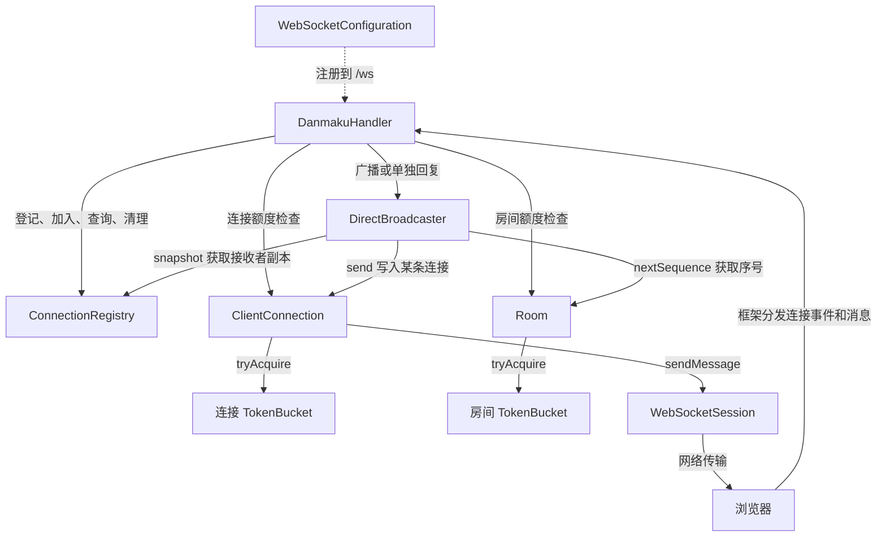

# 类之间的调用关系：沿一条弹幕看完整流程

记录日期：2026-10-23。本文对应当前直接广播实现，帮助理解各类职责与调用方向；没有改动业务代码。

## 一、先认识每个类的职责

下表中的源码路径相对于 `src/main/java/io/github/chocoemmm/danmakulab/`。

| 类 | 职责 | 主要配合对象 |
| --- | --- | --- |
| [DanmakuLabApplication](../src/main/java/io/github/chocoemmm/danmakulab/DanmakuLabApplication.java) | 启动 Spring Boot 服务 | Spring 创建和连接各个组件 |
| [LabProperties](../src/main/java/io/github/chocoemmm/danmakulab/config/LabProperties.java) | 保存 `application.yml` 中的 `lab.*` 参数，例如连接数上限、连接与房间的限流速率 | Configuration、Handler、Registry 读取它 |
| [WebSocketConfiguration](../src/main/java/io/github/chocoemmm/danmakulab/config/WebSocketConfiguration.java) | 将 `/ws` 注册给处理器，并配置底层 WebSocket 容器参数 | DanmakuHandler、LabProperties |
| [DanmakuHandler](../src/main/java/io/github/chocoemmm/danmakulab/protocol/DanmakuHandler.java) | 接收连接事件和消息，解析、校验、按 join/send/ping 分流并检查额度 | Registry、ClientConnection、Room、Broadcaster |
| [ConnectionRegistry](../src/main/java/io/github/chocoemmm/danmakulab/core/ConnectionRegistry.java) | 登记连接，维护连接与房间的关系，提供房间成员快照，回收失效连接和空房间 | 创建 ClientConnection、按需创建 Room |
| [ClientConnection](../src/main/java/io/github/chocoemmm/danmakulab/core/ClientConnection.java) | 包装一条真实连接，持有连接桶，统一保护该连接的发送操作 | TokenBucket、Spring 的 WebSocketSession |
| [Room](../src/main/java/io/github/chocoemmm/danmakulab/core/Room.java) | 保存房间名称、房间实例身份、房间桶和广播序号 | TokenBucket；成员名单由 Registry 维护 |
| [TokenBucket](../src/main/java/io/github/chocoemmm/danmakulab/core/TokenBucket.java) | 按经过的时间补充令牌，检查并扣减额度 | 每个 ClientConnection 和每个 Room 分别创建自己的实例 |
| [DirectBroadcaster](../src/main/java/io/github/chocoemmm/danmakulab/core/DirectBroadcaster.java) | 获取接收者、分配序号、组装 JSON，并逐个同步发送；也负责单独回复控制消息 | Registry、Room、ClientConnection |
| [ProtocolException](../src/main/java/io/github/chocoemmm/danmakulab/protocol/ProtocolException.java) | 携带可解释的业务拒绝原因，例如未加入房间或发送超速 | Handler 捕获后转换为客户端响应 |

## 二、启动配置关系与运行时调用关系

启动时，`main()` 调用 `SpringApplication.run(...)`。Spring 扫描组件，读取配置，创建组件并根据构造器参数注入依赖。“注入”就是把已经创建好的依赖对象交给需要它的对象，例如把 Registry 和 Broadcaster 交给 Handler。

Spring 调用 `WebSocketConfiguration.registerWebSocketHandlers(...)`，执行 `registry.addHandler(handler, "/ws")`。以后浏览器连接 `/ws`，框架就会通知这个 Handler。这里参数里的 `WebSocketHandlerRegistry` 是 Spring 的端点登记工具，与项目管理房间成员的 `ConnectionRegistry` 是不同对象。

下面图中的实线表示主要运行时调用，虚线表示持有对象或配置关系，不代表所有类依次执行：



`LabProperties` 是配置来源，不参与每条消息的顺序流转。`ProtocolException` 是失败时抛出和捕获的数据载体，也不是正常发送路径上固定调用的一站。

## 三、浏览器建立连接

```text
浏览器连接 /ws
→ Spring 调用 DanmakuHandler.afterConnectionEstablished(session)
→ ConnectionRegistry.register(session)
→ new ClientConnection(session, 连接速率)
→ ClientConnection 内部 new TokenBucket(连接速率)
→ Registry 保存“连接 ID → ClientConnection”
```

此时连接已经登记，但还没有加入房间。超过连接数量上限时，Registry 抛出 `ProtocolException`，Handler 在建立连接的处理方法中捕获并关闭这条连接。

## 四、加入或切换房间

浏览器发送 `type = join` 的 JSON，框架调用 `DanmakuHandler.handleTextMessage(...)`：

```text
Handler 查找连接、解析并校验消息
→ ConnectionRegistry.join(connection, roomId, nickname)
→ 校验容量；目标房间不存在时，按需创建 Room
→ Room 内部创建自己的 TokenBucket
→ Registry 更新连接所属房间和房间成员名单
→ 返回 Membership(room, nickname)
→ DirectBroadcaster.reply(...) 回复 joined
→ ClientConnection.send(...)
→ WebSocketSession.sendMessage(...)
→ 浏览器收到加入确认
```

`Membership` 是 Registry 内部定义的 `record`，可以理解为“这条连接属于哪个房间、当前昵称是什么”的只读数据组合。例如小明加入 lobby，就记录对应 Room 引用与“小明”。它不是新的连接，也不另外创建令牌桶。

Room 已经存在时复用原实例，房间内所有发送者因此共享同一个房间桶。重复加入当前房间只修改昵称，不会把房间令牌恢复成满桶。

## 五、一条弹幕从输入到广播

假设 A、B、C 都加入 lobby，A 发送“你好”：

```text
A 的浏览器发送 type=send
→ DanmakuHandler.handleTextMessage(...)
→ 根据 type 调用 Handler 私有方法 send(...)
→ 校验消息 ID、正文、时间戳
→ ConnectionRegistry.membership(A)，取得房间和昵称
→ A.admitMessage()
    → A 的 TokenBucket.tryAcquire()：补充、检查、通过则扣 1 个
→ room.admitMessage()
    → lobby 的 TokenBucket.tryAcquire()：补充、检查、通过则扣 1 个
→ DirectBroadcaster.broadcast(...)
    → 锁住当前 Room，保证同房间的广播依次推进
    → ConnectionRegistry.snapshot(room)，取得 [A, B, C] 的副本
    → Room.nextSequence()，生成本条广播序号
    → 把弹幕编码为 JSON，一条弹幕只编码一次
    → reply(A, accepted)，先告诉 A 已通过准入
    → 依次 reply(A, 弹幕)、reply(B, 弹幕)、reply(C, 弹幕)
        → 各自的 ClientConnection.send(...)
        → 各自的 WebSocketSession.sendMessage(...)
```

“快照”就是把当时的成员名单复制一份。例如取得 [A, B, C] 后，即使 D 加入，也不会自动进入本次名单。复制时短暂持有 Registry 锁，网络发送时已释放该锁；这样慢连接不会让成员登记一直等待整轮网络发送。

发送者 A 也在接收名单中，因此能收到自己发出的弹幕。`accepted` 仅说明通过准入，不能证明 B、C 的浏览器已经收到。当前在调用线程中同步逐个发送，没有后台广播队列，慢连接仍可能拖慢广播。

注意同名方法的区别：

- `DanmakuHandler.send(...)`：处理用户输入，包括校验、限流和发起广播。
- `ClientConnection.send(...)`：将一条服务端输出写入实际连接。加入确认、拒绝、pong 和弹幕都通过这里。

## 六、拒绝、心跳与断开

业务校验或额度检查失败时，Handler 或 Registry 抛出 `ProtocolException(reason)`，Handler 捕获后调用自己的 `reject(...)`，再交给 `DirectBroadcaster.reply(...)` 返回原因。这个异常是业务控制流的一部分，并不自动意味着服务器崩溃或需要关闭连接。

当前发送检查顺序为连接桶、房间桶；连接桶通过就已扣减。房间拒绝时不会退回连接额度，用于约束持续尝试发送的连接。房间桶限制全房间合计输入，避免每人都未超速、合计广播压力却很大的情况；它不保证把额度平均分给每个人。

心跳走短路径：浏览器发送 ping → Handler → Broadcaster.reply(pong) → ClientConnection.send → Session。心跳不经过弹幕的两个令牌桶。

正常断开走清理路径：框架调用 `Handler.afterConnectionClosed(...)` → `Registry.remove(id)` → 移除连接与成员关系 → 最后一个成员离开时删除 Room。

若广播写入失败，由 Broadcaster 先调用 `Registry.remove(id)`，再调用 `ClientConnection.closeAfterFailure()` 尝试关闭连接，并继续处理其他接收者。之后断开事件再次触发清理也是安全的，即“幂等”：重复清理同一个 ID 不会重复扣减成员数。

## 七、对象数量与不同锁的范围

当前普通 Spring 组件按容器默认单例作用域管理。例如多个连接共用一个 Handler、一个 Registry 和一个 Broadcaster；连接和房间对象则由 Registry 按业务需要创建。

假设 3 条连接处于同一个房间，存在 3 个 ClientConnection、3 个连接桶、1 个 Room 和 1 个房间桶，共 4 个 TokenBucket。持有关系可以用来解释各类锁保护的范围：

| 锁 | 保护什么 | 为什么需要 |
| --- | --- | --- |
| `TokenBucket.tryAcquire()` 的桶实例锁 | 一个桶的余额与结算时间 | 防止重复放行最后一个令牌 |
| Registry 同步方法的 Registry 实例锁 | 连接、成员关系、房间和成员名单之间的一致性 | 换房与清理涉及多张表，必须协调更新 |
| Broadcaster 中的 `synchronized(room)` | 一个房间的序号分配与整轮广播 | 防止同房间两轮广播交错 |
| `ClientConnection.send()` 的连接实例锁 | 对该 Session 的发送操作 | 防止弹幕和控制回复并发写入同一连接 |

Room 对象锁与它持有的 TokenBucket 对象锁是不同的锁；ClientConnection 的发送锁与它持有的连接桶锁也不同。不要因为桶字段属于连接或房间，就把它们当作同一把锁。

本文基于源码梳理调用关系，未新增或运行测试，不代表新增性能验证结果。
