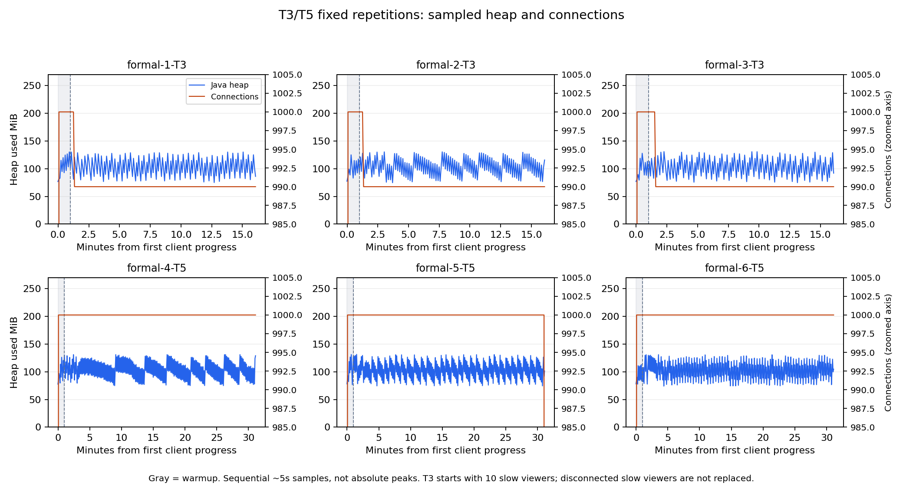
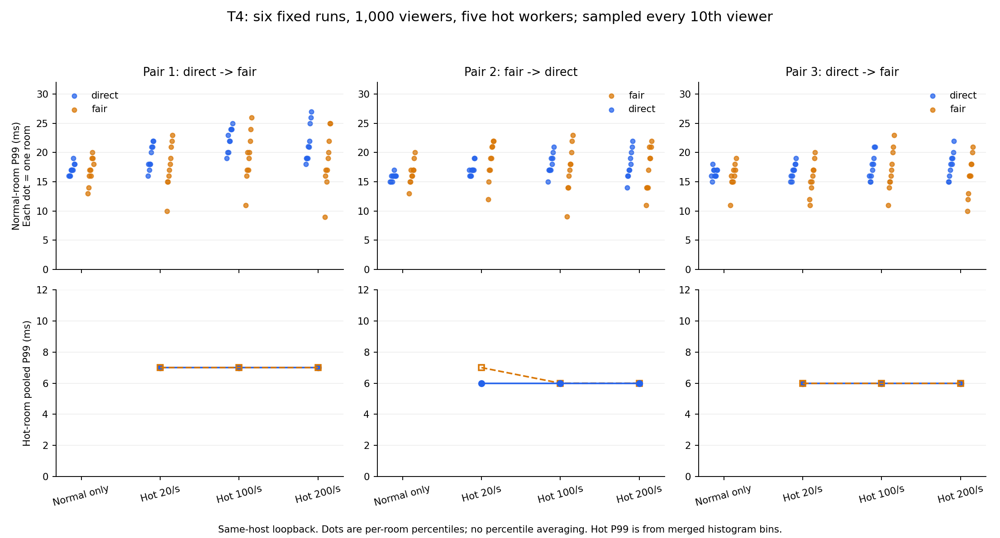

# 性能实验报告

更新日期：2026-10-30。项目用于研究WebSocket扇出、慢消费者与房间调度；所有数字以对应原始记录为准。本报告区分已测条件、实现保证和未验证范围，不把计划目标写成实测容量。

2026-10-30另补[Linux/JDK21小规模诊断](results/2026-10-30/linux-io-01/notes.md)：WSL2内11连接、40条输入/s、四组各90秒，同步停读P99为4322ms，异步停读正常36000/36000次全收、P99为7ms；TCP/线程栈复现同步写持有房间锁，异步模式保留慢探针降级。以下千连接和双节点历史数据仍属于原Windows/JDK25环境。

## 阅读结论

现有证据最明确的收益是：把共享发送线程从同步网络等待中释放出来，使多个慢读连接不再占满提交线程。在固定本机负载下，正常观众完整接收有实测支持；慢观众仍可能丢弃或断开。

公平房间调度提供有界入口和有限批次轮转。正式对照没有证明fair在所有负载都更快；最终发布制品改用五热点进程后，已完整通过三对正式T4重复，旧工具失败记录保留。不把机制名称直接写成延迟收益。

Redis双节点实现了跨实例广播与故障后新消息恢复。它增加网络路径和队列，不提供可靠补发、集群严格序号或集群总限流；连接分散不能直接表述为容量翻倍。

## 条件与制品

- Windows 11同机回环，Java服务器、压测器及其他日常程序共享主机；不是公网或独占服务器测试。
- Ryzen 9 8945HX、32个逻辑处理器，约31.3GiB内存；源码release 21，实际Oracle JDK25.0.1，Boot3.5.16/Tomcat10.1.55。
- 通常为`-Xms128m -Xmx256m`、buffered输出、8个共享异步提交线程；容器另有I/O和处理线程，不能写成整个JVM只有8个线程。
- 完整输入JSON为256个UTF-8字节，广播增加来源、昵称等字段，实际广播大于256字节。发送者也在观众分母中。
- 每条观众连接解析真实弹幕后才计数；accepted、服务端写完成和观众接收分别记录。所有正常观众留在完整率分母内。

| 制品 | SHA-256前缀 | 对应证据 |
| --- | --- | --- |
| 同步发送池旧版本 | 1DB6EA89… | 多慢连接占满8个发送线程的失败复现 |
| 异步输出单机版本 | 63C3F3BF… | 正式T2/T3/T4/T5与T6首轮 |
| Redis首轮实网版本 | D54AC0E0… | 100/1000观众、Redis/节点故障与慢读 |
| v0.3.0.0最终候选 | BC565288… | 82项Java、1项真实Redis、44项Python回归；后续T4三对与T3/T5三轮重复；本次用户82项常规Java回归 |

完整哈希与源码、命令、环境位于各结果目录。历史数据不会被改写成“最终候选全部长测”；本轮27个运行源码/配置文件与发布源码归档逐字节相同，只补充重复编排和制品路径记录工具。

## 已有场景结果

| 场景及测量窗口 | 真实接收 | 抽样延迟 | 解释与限制 |
| --- | --- | --- | --- |
| 最终候选T3：初始990正常＋10慢读，900秒，3轮 | 正常组53460000/53460000 | 各轮P99=31/30/29ms | 慢组保护性断开后不补建；丢弃/写失败单独记录 |
| 最终候选T5：1000正常，1800秒，3轮 | 108000000/108000000 | 各轮P99=36/39/37ms | 每轮另有60秒预热，不混入测量总数 |
| T4：1000观众，四阶段各180秒，3对6轮 | 69267000/69267000，全部收齐 | 热点合并P99=6～7ms；普通每房间P99最大27ms | 五热点进程；同机回环，未证明fair普遍更快 |
| T2：1000正常观众，5/20/50/100输入/s，各180秒 | 90万/360万/900万/1800万，各档全部收齐 | P99=9/9/9/51ms | 显式房间额度200/s、4个客户端进程；不是默认50/s配置的容量，也没有测最高边界 |
| 异步单机首轮T3（旧制品）：初始990正常+10慢读，20/s，900秒 | 正常1782万/1782万 | P95/P99=28/35ms | 10个慢观众被关闭后不补建；慢组1320次输出丢弃、2次写失败，不能称整个场景零错误 |
| 异步单机首轮T5（旧制品）：1000正常观众，20/s，1800秒 | 3600万/3600万 | P50/P95/P99=16/28/35ms | 每观众36000条；含60秒预热共3720万次，计数与清理一致 |
| T6：100/500人，一半断连重入，3个故障周期 | 必达11万/55万，全部收齐 | 各恢复窗口P99=3～4/15～16ms | 周期不等于三次独立实验；离线潜在需求仍记录，不承诺历史补发 |
| Redis：100/1000正常观众，20/s，60秒 | 12万/120万，全部收齐 | P99=7/40ms | 两JVM共享同一主机；不能与单机不同工具/窗口的P99直接相减为总线耗时 |

T3慢组通过缩小TCP接收缓冲并限制recv速率制造背压，继续向服务器发心跳。它不是断网，也不是只停止页面渲染。服务端写入可能先填满内核/容器缓冲，随后才暴露慢读；连接超时或过载保护生效后，正常组可能恢复。

小规模修复对照中，同样20连接、其中10个慢读、20/s、20秒，旧同步发送池正常接收1566/4000；异步输出后4000/4000。这里比较的是发送等待隔离，不能拿千连接与20连接的不同场景混算提升倍数。

证据：[T2](results/2026-10-26/t2-report.md)、[异步修复与T3](results/2026-10-26/async-writer-report.md)、[用户正式T5](results/2026-10-26/t5-094730/notes.md)、[T6](results/2026-10-26/t6-report.md)、[Redis](results/2026-10-26/redis-report.md)。

## 最终候选T3/T5三轮与常规回归（2026-10-28）

T3/T5最终候选三轮独立重复已完成，六轮全部通过：测量期正常组累计161460000次全收；T3各轮P99为31/30/29ms，T5为36/39/37ms。93个冻结文件、源码ZIP、310个原始索引文件及实际JAR身份核对，全部12项Gauge归零。用户逐轮离线审计通过，13:42:45执行的82项常规Java测试与13份Surefire XML核对一致，失败/错误/跳过均0。本次没有重跑真实Redis集成，没有改Java或JAR，也没有提交推送。

[T3/T5逐轮报告](results/2026-10-28/longrun-repeat-02/notes.md)保留输入、接收、延迟、慢组降级及资源数据。T3三轮输出丢弃分别1300/1320/4040、写失败10/0/9；正常组均全收且无失败。T5三轮输出/房间丢弃、写失败均0，含预热每轮37200000次与服务端expected/enqueued/submitted一致。场景和制品相同，轮次独立新JVM，没有用旧轮补次数。



测量期Java堆采样峰值约130～132MiB，有回收锯齿；工作集峰值345～371MiB。Python工作集119～159MiB。CPU采样端点窗口平均Java约0.67～0.74核、Python约0.41～0.57核，样本最大在途写20条。它们是同机采样，不作为独占机器容量或绝对峰值。

[最终常规回归记录](results/2026-10-28/final-regression/java-test-verification.json)来自用户运行mvn test及本地XML核对，不是新跑的Redis集成。本轮补齐长期验证与交付文档，未宣称任意慢观众比例隔离、全局可靠交付或最大容量。

## T4三对正式重复完成（2026-10-28复核）

2026-10-28复核完成：固定direct/fair、fair/direct、direct/fair六轮正式T4全部通过，每轮11544500/11544500，合计69267000/69267000次真实投递。所有进程最大发送滞后21～28ms，热点合并抽样P99为6～7ms；12项Gauge全部归零，自建进程和防休眠请求清理。70项Python、19项Node、两类各5项工具检查及4项正式门控检查通过；617个原始索引文件、66份压缩证据复核，89个冻结源码和JAR未变。仅T4三对完成，不把T3/T5、异机、完整P0和最终交付一并勾选；不宣称fair普遍更快或旧根因全部定位。见[正式逐轮报告](results/2026-10-27/t4-workers-formal-01/notes.md)。本轮未提交推送。

四阶段各180秒，1000名观众、单实例local、buffered、8个提交线程、五热点进程和一个普通客户端进程。每轮72000次尝试，接受36049、按房间限流拒绝35951；普通房间无拒绝。热点10824500次与普通720000次需求均逐观众收齐，未知确认、漏收、重复、串房、乱序、写失败、输出/房间丢弃为0。

| 对/顺序 | 模式 | 实收/应收 | 普通房间四阶段最慢P99 ms | 热点20/100/200合并P99 ms |
|---|---|---:|---|---|
| 1-1 | direct | 11544500/11544500 | 19/22.01/25.01/27 | 7/7/7 |
| 1-2 | fair | 11544500/11544500 | 20/23/26/25 | 7/7/7 |
| 2-1 | fair | 11544500/11544500 | 20/22/23/22 | 7/6/6 |
| 2-2 | direct | 11544500/11544500 | 17/19/21/22 | 6/6/6 |
| 3-1 | direct | 11544500/11544500 | 18/19/21/22 | 6/6/6 |
| 3-2 | fair | 11544500/11544500 | 19/20/23/21 | 6/6/6 |

热点合并毫秒直方图，普通房间保留每间的P99，表中仅取各阶段最大值，不平均P99。正式模式普通客户端未导出定时器漂移，保留未知；所有进程发送滞后则完整记录，21～28ms。实际输入与原门槛吻合。



Java输入期采样平均约0.71～0.76核、全部6个k6约1.86～2.06核；工作集采样峰值约332～342MiB和423～432MiB。72分钟输入、正式墙钟约76.58分钟，全部新JVM顺序运行。只说明本套工具维持了本机指定负载及投递完整，不表述为容量上限、Java优化或旧1033ms根因已完全确认。

以下两节保留新批次之前的历史状态，不能将旧失败移除或拼入本批六轮。

## 旧工具T4复测：失败记录保留

统一制品为BC565288…，计划每次新建JVM顺序运行6次，每对轮换direct/fair先后；实际第二批在第三次运行失败后停止。有效一对direct/fair分别收齐11546500/11544500次，普通房间各阶段最慢房间P99分别33.01/39.01/48/56ms与29.01/53/58.02/47ms。后续fair虽收齐11544500次，但最大计划发送滞后1033ms超过`max<1000`门槛，不能计通过。

两者都使用buffered异步输出，区别仅在房间调度方式，不是同步网络写与异步写的比较。[复测与诊断报告](results/2026-10-27/t4-repeat-report.md)保留全部尝试、曲线、后续未成功的短轮试验及清理结果。业务与JAR未改；不能因为后续某些延迟点较低就忽略失败门槛。

负载为10个普通房间、每房间50人和2条输入/s，另一个热点房间500人，分四阶段尝试0/20/100/200条/s，每阶段180秒。房间额度保持默认50/s，所以热点超额输入应被拒绝；仅已接受输入进入投递需求。普通与热点各用一个k6进程，共同开始。

首批在第一轮fair期间遇到系统睡眠，判失败并保留[中断说明](results/2026-10-27/t4-repeats-formal-01/README.md)。[第二批](results/2026-10-27/t4-repeats-formal-02/batch-config.json)在第二轮fair遇到工具发送滞后门槛失败；两批均不能计为三组完成，也不拼接成功轮凑次数。每轮保留两客户端汇总、服务端前后/时序、原始输入与接收计数、清理Gauge和JVM启动/结束记录。

计时需区分：`maxSendLagMs`是计划发送时刻到实际发送所在tick的滞后；`latencyMs`从该tick记录的`sentAt`计至接收回调，含客户端接收处理等待，**不把发送前的计划滞后直接相加**。两个进程仍共享CPU与内存，两项都不能单独归因服务端。

当天晚间补齐[短诊断时间线](results/2026-10-27/t4-diagnostic-report.md)：固定四轮千连接、各阶段10秒合计2658000次全收，开始关闭前客户端均已收齐；受控停顿按原门槛失败并完整归档。旧1033ms/关闭拥堵未复现，所以不是根因修复或三对正式验收的证据。采样需求差值不代表精确服务端队列，诊断收尾与默认模式分开报告。

```powershell
pwsh -NoProfile -File scripts/run/repeat-hotspot.ps1 -Rounds 3 -PhaseSeconds 180
python scripts/tests/repeat-hotspot-summary.test.py docs/results/日期/批次目录 --formal
python docs/results/2026-10-27/analyze-t4-repeats.py.txt docs/results/日期/批次目录
```

## 热点压测器1/5进程短对照（2026-10-27）

2026-10-27热点工作进程接续：新增同协议1/5热点进程、全局发送台账和逐观众位图对账、一键短验收/正式门控与压缩索引。67项Python、19项Node及两类各5项工具检查通过；60观众两次冒烟全收，单进程受控1.5秒停顿触发1501ms原门槛并完整保留失败。固定千连接1/5/5/1四次短轮结果为失败/通过/通过/失败，五进程两轮各664500/664500次全收；全部12项清理归零，自建JVM已停。短轮工具与JAR相同，27个运行源码文件仍与发布归档一致。用户明确要求暂不正式长测，六轮全部未执行，三对正式T4仍未完成；没有将工具拆分写成Java优化或旧根因修复。详见[短对照报告](results/2026-10-27/t4-workers-short-01/notes.md)。未提交推送。

两次单热点进程在100/s阶段未维持输入，最大发送滞后1181/1478ms；两次五热点进程维持20/100/200输入，所有进程最大发送滞后18/20ms，热点合并P99分别13/12/8ms与11/18/8ms。新客户端校验和计时开销有别于历史工具，当前只说明本套工具的进程拆分差异；正式三对仍未执行。客户端合计采样工作集也从单进程基线251～258MiB变为五进程378MiB左右，不能只报告每个工作进程占用下降。

## 资源与统计口径

单机T5约5秒采样371次，已用堆采样最大139.7MiB，Java工作集367.9MiB，Java/Python平均约0.834/0.524个等效逻辑核；应用在途写采样最大15条。工作集包含非堆和线程栈等，可能大于256MiB堆上限。

队列预算计保留载荷，不能当作JVM/容器/内核总内存；采样最大不是绝对峰值，采到零也不能证明从未排队。CPU累计秒差除墙钟秒得到等效逻辑核，不是整个主机的CPU百分比。指标逐项读取，不是全系统原子快照。

百分位必须保留口径。T2多进程先合并直方图桶再求总体P99；T4保留每房间每轮的P99范围，不能平均多个P99后冒称“整体P99”。完整率始终检查全部必达观众，延迟才抽样。

## 仍未验证与后续交付

- 千连接通过不等于最大容量；5000/10000连接、公网或独立压测主机尚无证据。Linux/WSL2已有11连接四组诊断，尚无千连接Linux长测证据。
- T3/T4/T5关键独立重复已分别完成，人工演示与发布前检查仍须完成，不能替代其他扩展验收。
- Redis的60秒与短故障验证不是30分钟双节点稳态；桥接/本地房间压满的部分覆盖来自受控离线测试。
- 不提供账号权限、普通弹幕历史、可靠交付、永久去重、全局严格顺序或透明负载均衡。
- 还需核对完整P0交付清单、启动演示与最终简历措辞；本报告不替代这些操作验收。
