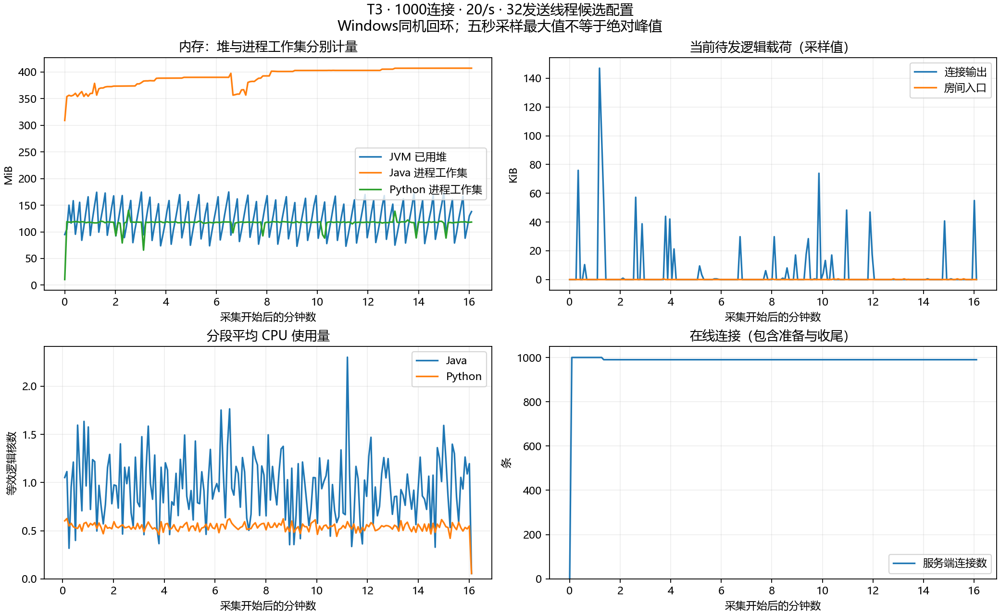
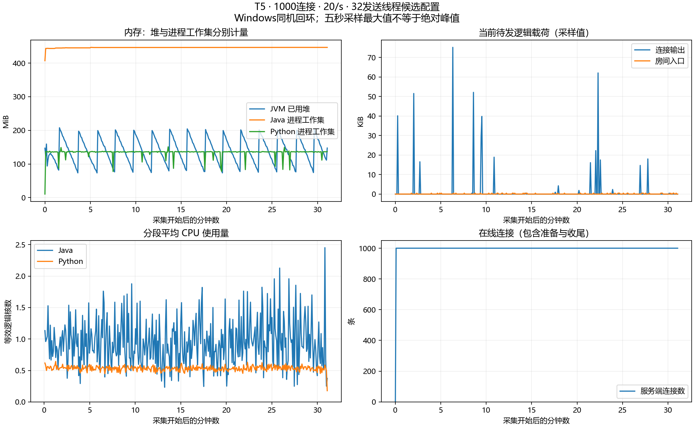

# 正式窗口测试记录

本轮已完成一对正式T4、一次15分钟T3和一次30分钟T5，均通过各自口径的复核。负载顺序执行，未并行施加不同场景。状态索引见 [formal-longrun-index.json](formal-longrun-index.json)。**默认8发送线程的混合预检失败；T3/T5通过项属于显式32线程候选配置，不能称默认配置全部通过。**

## 制品与配置

固定 JAR SHA256：`1DB6EA8966FFAF75496B5B8EA68E2B10DB213DCA58671E290A1A0344336B0B9D`；JDK25.0.1运行、源码release21，Windows同机回环，`-Xms128m -Xmx256m`。服务端Java实现未在测试中修改或重建，代码仍在未提交工作区，以源码与制品哈希绑定。

主机为 Ryzen 9 8945HX、32逻辑核，Python3.14.2、k6 v2.0.0-rc1。完整输入JSON为256个UTF-8字节，广播添加服务端字段，不能称完整广播256字节。T3/T5使用同一个候选JVM，T5承接T3且未重启；每轮先确认零连接，以前后差值统计计数，进程高水位不随测试清零。

T4 两种房间调度均为 buffered 输出、8发送线程；后续T3/T5为显式32发送线程候选参数。默认8线程混合预检失败，原因与单变量对照完整保留在 [诊断记录](mixed-writer-diagnosis.md)，不能用候选配置覆盖默认成绩。

## 已完成的正式 T4

两组均为1000连接：10个普通房间各50人、各2/s，热点500人依次尝试0/20/100/200/s；四阶段各180秒。普通与热点由两个独立k6进程管理，共同绝对时间计划，有限排空。房间令牌桶仍50/s、容量50，不暗中提高接受量。

| 项目 | 原调度 | fair |
| --- | --- | --- |
| 实际发送输入 | 72000 | 72000 |
| 接受 / 限流拒绝 | 36049 / 35951 | 36049 / 35951 |
| 客户端唯一接收 / 预期 | 11544500 / 11544500 | 11544500 / 11544500 |
| 重复、乱序、串房、缺失结果 | 0 | 0 |
| 写失败、输出丢弃、入口取消 | 0 | 0 |
| 模式、阶段对齐、计数、清理 | 通过 | 通过 |

普通房间每阶段各360条接受、0拒绝、18000/18000收到。表中区间是10个普通房间各自P99的最小～最大，不平均分位数：

| 阶段 | 原调度普通P99 | fair普通P99 | 原调度热点P99 | fair热点P99 |
| --- | --- | --- | --- | --- |
| normal-only | 22～25ms | 18.01～25ms | 无输入 | 无输入 |
| hot-20 | 21～28ms | 14～25ms | 22ms | 21ms |
| hot-100 | 20.01～26ms | 13～27ms | 635ms | 407ms |
| hot-200 | 21～26ms | 14～28ms | 87ms | 90ms |

两种调度在此负载均未把正常房间拖到数百毫秒。热点100/s阶段的压测端最大发送滞后仍分别为739/537ms，因此不能把热点P99差异全部当作服务端优化收益。当前只有一对正式窗口，不是关键对照三次重复结论，也不证明最大容量或任意热点数量隔离。

原始证据：[原调度](formal-t4-direct-01/run-status.json)、[fair](formal-t4-fair-01/run-status.json)；各目录均保存客户端分组、服务端前后/时序、命令、环境与哈希。

## 正式 T3：32线程候选配置

1000连接全部加入，60秒预热后，990个正常观众与初始10个慢读观众共同运行900秒，输入20/s。含预热19200条输入全部被接受；测量期18000条，正常观众收齐17820000/17820000次，预热也收齐1188000次。重复、乱序、协议错误、正常连接失败、缺失接受结果均为零。

正常组1782000个抽样延迟：P50=17ms、P95=29ms、P99=37ms、最大120ms；实际输入20.00004/s、最大发送计划滞后94.07ms。服务端记录1330次输出丢弃、10次关闭、6次写失败、0次房间输入取消；慢组发生10次读取断连，正常组没有失败。这些是慢连接降级证据，不应把整个场景描述为“零错误”。

慢组测量期共收到812次，最初成员对应潜在需求180000次；各探针读取28648～56680字节，最终全部断开。不能剔除它们后宣称所有观众完整率100%。采集、服务端输入/接受计数、正式时长、正常组SLO及九项清理归零均通过独立复核，见 [原始状态](formal-t3-32writers-01/run-status.json)、[客户端明细](formal-t3-32writers-01/client/summary.json)。

## 正式 T5：32线程候选配置

1000个正常连接，60秒预热、1800秒测量，20/s。测量期36000条输入、36000000/36000000次唯一接收；预热1200000次也全部收齐。含预热37200条输入全部接受，服务端expected/enqueued/submitted均为37200000，与客户端总接收完全一致。

3600000个抽样延迟：P50=17ms、P95=29ms、P99=36ms、最大96ms；实际输入19.99999/s、测量1800.001秒、最大发送计划滞后95.18ms。重复、乱序、协议错误、连接失败、输入拒绝、输出丢弃、写失败及房间输入取消均为零。进程、采集、计数、正式时长、正常组SLO及九项清理均通过，见 [原始状态](formal-t5-32writers-01/run-status.json)、[客户端明细](formal-t5-32writers-01/client/summary.json)。

## 资源时序

以下为约五秒采样，覆盖准备、预热、测量与排空；最大值不是绝对峰值。CPU为累计秒差除以墙钟秒，单位是等效逻辑核，不是整机百分比。

| 项目 | T3候选 | T5候选 |
| --- | --- | --- |
| 资源采样数 | 192 | 370 |
| 已用堆采样最大 | 174.8MiB | 207.8MiB |
| Java工作集采样最大 | 407.2MiB | 446.8MiB |
| Python工作集采样最大 | 140.5MiB | 151.1MiB |
| Java平均等效核数 | 0.949 | 0.947 |
| Python平均等效核数 | 0.538 | 0.533 |
| 当前输出载荷采样最大 | 150524B | 76956B |
| 当前房间入口载荷采样最大 | 485B | 485B |
| GC暂停次数 / 累计时间差 | 238 / 0.283s | 356 / 0.379s |

采样未超输出128MiB、房间入口4MiB预算；测试后另取端点确认九项状态归零。图中最后一个五秒采样可能早于客户端清理，归零证据以`server-after.json`为准。Java工作集还包括非堆、线程栈、直接缓冲和运行库等，不能与256MiB最大堆或逻辑载荷预算混为一谈。本机未采集完整内核socket内存，也不据这一窗口证明绝无内存泄漏。

候选进程的输出字节高水位在T3之前已为682146B，T3/T5后未再刷新；不能把高水位差零解释成没有排队。资源派生明细见 [T3](formal-t3-32writers-01/resource-summary.json)、[T5](formal-t5-32writers-01/resource-summary.json)，生成代码和哈希在 [工具验证](longrun-tool-verification/notes.md)。T4资源原始数据及派生汇总保留在各自目录，原采集入口未记录GC，不能补造GC结果。





## 工具与复核入口

执行命令见 [LONGRUN](../../LONGRUN.md)，每轮的`command.json`、`server-command.txt`、`config.json`、`environment.json`保存实际参数。Python离线测试12项通过；Java仍使用此前58项通过的同一制品，本轮未重建。单独复核命令：

```powershell
python scripts/tests/hotspot-summary.test.py docs/results/2026-10-25/formal-t4-direct-01
python scripts/tests/hotspot-summary.test.py docs/results/2026-10-25/formal-t4-fair-01
python scripts/tests/longrun-summary.test.py docs/results/2026-10-25/formal-t3-32writers-01 --formal
python scripts/tests/longrun-summary.test.py docs/results/2026-10-25/formal-t5-32writers-01 --formal
```

T3慢观众按真实recv字节限速1024B/s，若服务端断开不自动补建；初始1%不是全程恒定在线1%。正常观众不从分母移除，慢组同时报告最初人数对应的潜在投递分母。Python asyncio 与T4的k6是不同客户端，不能直接比较其延迟来宣称优化比例。

## 仍需遵守的边界

测试进程退出0不等于全部验收；需同时核对完整率、SLO、实际输入、工具滞后、计数、背压与清理。正式时长之外，关键对照三次重复、Linux/异机验证和T2/T6等其他矩阵项不在本轮通过项中。所有结果仅代表同机、指定参数与这一轮窗口。

下一步先决定多个慢写下的共享发送池策略与默认参数，再做关键对照三次重复、完整P0清单与交付材料；不能只增加线程就宣称任意慢连接比例隔离，也不能据此直接启动Redis扩展。代码与归档仍在本地，未在本轮自动提交或推送。
