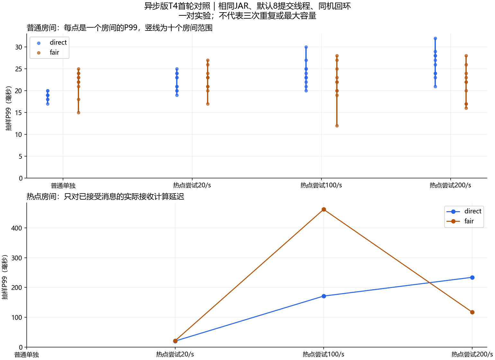

# 异步版T4：热点房间正式对照

本报告记录T4验收时点；同日后续已完成 [T2首轮正式阶梯](t2-report.md)。项目当前状态以README和PLAN的最新记录为准，下文剩余工作保留当时上下文。

**本轮结果：两种房间调度都收齐消息，普通房间未被热点拖到数百毫秒。fair没有在所有档位都更快，暂不宣称性能优势。** 同一异步JAR、默认8提交线程的正式T3、T4、T5现各有首轮通过记录；关键对照三次重复、T2/T6及完整P0仍未完成。

可以把实验理解为：10个小房间照常聊天，再让一个500人的房间越来越忙。房间最多接受约50条/秒，所以热点尝试100/200条时会限流；我们既数清拒绝的输入，也检查接受后的每次观众投递，不能把拒绝算成已接受消息丢失。

## 主对照与控制变量

主对照为 [原调度02](async-t4-direct-02/notes.md) / [fair02](async-t4-fair-02/notes.md)。均1000连接：10×50普通观众、每房间2/s，热点500观众尝试0/20/100/200条/秒，四阶段各180秒，准备30秒、排空5秒；普通/热点两个k6进程按同一绝对时间计划运行。输入完整JSON256个UTF-8字节，广播添加服务端字段，不能称完整广播256字节。

两组依次施压，使用各自新启动的JVM。都开启buffered异步输出、默认8提交线程、`-Xms128m -Xmx256m`、50/s房间令牌桶和原预算/超时；只切换`lab.dispatch.mode=direct|fair`。这里direct是房间分发方式，连接输出仍是异步邮箱，不能读成逐连接同步网络写。

固定JAR SHA256：`63C3F3BF6F415E0165FDA5EE710ACDFCA896D8E96981A0539314DD88C4994E28`。Windows同机回环、JDK25.0.1、Boot3.5.16/Tomcat10.1.55、k6 v2.0.0-rc1、PowerShell7.6.5；Java与两个k6共享CPU/内存。两组51份源码清单完全相同，实际模式由命令、配置和Gauge核对；源码仍在未提交工作区，版本由SHA清单和JAR绑定。

## 输入与真实接收

| 项目 | 原调度 | fair |
| --- | --- | --- |
| 实际输入 | 72000 | 72000 |
| 接受 / 房间限流拒绝 | 36049 / 35951 | 36049 / 35951 |
| 实际唯一接收 / 应有投递 | 11544500 / 11544500 | 11544500 / 11544500 |
| 普通房间拒绝 / 漏收 | 0 / 0 | 0 / 0 |
| 重复、乱序、串房、缺失结果、异常断连 | 0 | 0 |
| 写失败、输出丢弃、入口取消、采集错误 | 0 | 0 |
| 进程、对齐、服务端计数、预算与在途写清理 | 通过 | 通过 |

每个普通房间每阶段接受360条，50位观众实际收到18000/18000次；10个普通房间四阶段合计720000次。热点三档分别接受3600/9048/9001条、拒绝0/8952/26999条，两组完全一致。令牌桶的初始容量和边界时刻令接受量不必恰好等于50×秒数，不能偷偷替换逐条统计分母。

这不是服务器调用过send就算收到：k6逐连接解析danmaku并校验本轮标识、房间/实例、正文、时间戳、重复及序号，再与逐输入accepted状态计算的需求核对。提交成功计数也单独与客户端真实接收吻合。

## 延迟：普通与热点分别看

每10个观众抽一个测延迟；完整率仍检查所有观众。每个普通房间每阶段1800个延迟样本，热点三个输入阶段各180000/452400/450050个样本。下表普通范围为10个房间各自P99的最小～最大，未平均分位数。

| 阶段 | 原调度普通P99 | fair普通P99 | 原调度热点P99 | fair热点P99 |
| --- | --- | --- | --- | --- |
| 普通单独 | 17.01～20ms | 15～25ms | 无样本 | 无样本 |
| 热点尝试20/s | 19～25ms | 17.01～27ms | 20ms | 21ms |
| 热点尝试100/s | 20～30.01ms | 12～28ms | 171ms | 462ms |
| 热点尝试200/s | 21～32.01ms | 16～28ms | 234ms | 117ms |

两组普通房间均保持几十毫秒，未复现早期单k6进程时约400ms的普通房间尾延迟。fair在热点100/s档更慢、200/s档更快；本轮支持“此负载下普通房间维持完整接收和较低尾延迟”，不支持“fair全面更快”。

普通输入最大发送滞后两组均24ms；热点100/200档原调度295/224ms、fair524/130ms。实际热点速率约100/200条/秒、各房间速率符合目标±5%，但输入回调的瞬时滞后和同机共享资源仍会影响端到端延迟。通过小于1000ms的工具门槛不表示不存在工具影响，也不能据这些分位数精确分解服务端耗时。

## 资源与回收

每组150次约五秒采样，覆盖准备、四阶段、排空；CPU由累计CPU秒差除以墙钟秒，单位是等效逻辑核，不是整机百分比。

| 资源 | 原调度 | fair |
| --- | --- | --- |
| JVM已用堆采样最大 | 142.9MiB | 139.8MiB |
| Java工作集采样最大 | 355.9MiB | 349.9MiB |
| Java平均等效逻辑核 | 0.690 | 0.733 |
| 普通k6 / 热点k6平均等效逻辑核 | 0.142 / 1.410 | 0.166 / 1.475 |
| 当前输出载荷采样最大 | 200979B | 174573B |
| 进程输出载荷高水位 | 3310835B | 5883816B |
| 房间入口载荷高水位 | 0B | 12688B |
| 在途写采样最大 | 17 | 24 |
| JVM活跃线程采样最大 | 123 | 124 |

应用提交线程活跃采样最大均8，不能称整个JVM只有8线程。fair入口五秒采样恰好都是0，但高水位12688B说明确实有短暂排队；这也展示了采样最大值不等于绝对峰值。GC首帧尚无指标，差值保留null，不写成“无GC”。逻辑预算不含容器/内核内存，工作集也不等于256MiB最大堆。

两组最终连接、房间、输出字节/条数/名额/任务/活跃提交/在途写，以及入口字节/条数/房间/就绪状态全部归零。末帧时序可能早于关闭，最终以各自server-after.json为准。资源曲线：[原调度](async-t4-direct-02/resources.png)、[fair](async-t4-fair-02/resources.png)，明细在各目录resource-summary.json。

## 失败轮与采集器修改

首次原调度01完整通过，fair01业务也收到11544500/11544500，但第494.690秒读取指标出现一次本机套接字资源错误，缺少该帧快照；因此fair01整体失败，未改成成功。见 [失败说明](async-t4-fair-01/notes.md)。

排查实测60次健康GET：原采集每次新建连接，共60个本地端口；共享WebRequestSession后只新增1个。只修正hotspot.ps1的HTTP连接复用与释放，读取失败仍计数并令整轮失败，未提高资源限制或伪造缺失帧。事后连接/内存数据不能完全还原错误瞬间，故不声称已确证端口耗尽是唯一根因。

修正后60连接短轮收到20690/20690，采集、计数、清理通过；再用同一修正采集器顺序重跑两组正式窗口02，两组均无采集错误。后端JAR、负载脚本、限流、线程和时长没有变化，原采集器字节及变更diff完整保留。本次没有修改Java或重建JAR，也没有重新把既有65项Java测试说成这次新跑的成绩。

## 复核与剩余工作

[验证索引](async-t4-verification/README.md)提供逐房间验收、异步在途/预算与制品检查、控制变量审计、失败分类和绘图源文件。原始脚本note里的“No room scheduler implemented”是旧说明，实际模式按命令/配置/Gauge判断，未回写历史报告文字。

本轮完成新版一对干净正式T4，额外原调度成功轮和fair采集失败轮均披露，不称三对成功。下一步仍需关键对照至少三次、T2吞吐阶梯、T6重连和完整P0回归，再整理最终报告与演示/简历材料；没有自动启动Redis扩展或提交推送。
