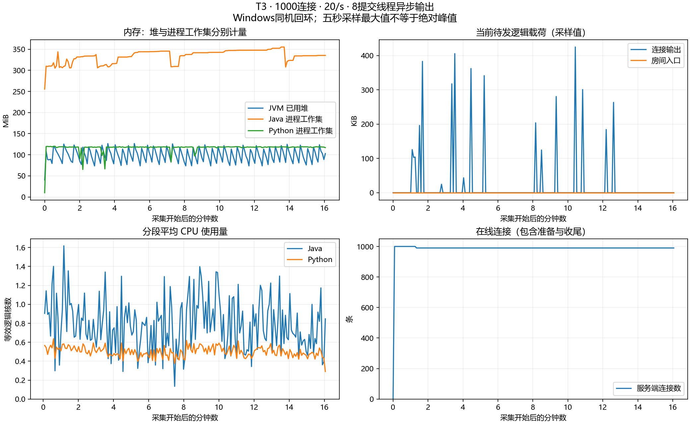

# 多慢连接占满共享发送池的修复

## 现象与复现

混合预检是正式长测前缩短时间、同时放入正常读者与慢读者的检查。慢读由原始TCP recv字节限速形成真实背压，心跳继续发送，不是断网或只延迟网页渲染。

2026-10-26重跑旧制品，fair+buffered、8发送线程、20连接（10正常、10慢读）、2秒预热、20秒测量、输入20/s、完整输入JSON256字节：正常1566/4000次，10正常读者全部失败，发送计划最大滞后16.06ms。与前一天的20连接及千连接失败一致，不能用压测端千连接过载解释这一最小场景。原始 [失败状态](writer-fix-before-20/run-status.json)、[客户端统计](writer-fix-before-20/client/summary.json)完整保留。

旧JAR SHA256：`1DB6EA8966FFAF75496B5B8EA68E2B10DB213DCA58671E290A1A0344336B0B9D`。本地另保留旧二进制`target/pre-async-writer-fix.jar`供复现，不重写历史结果。

## 修改与代价

buffered由Spring同步sendMessage改为原生Jakarta Async.sendText，提交线程不再等待网络完成。邮箱仍FIFO、每连接最多一条在途；完成回调后才释放预算并激活后续消息。回调可内联或延迟，重复通知与“回调后抛异常”只结算一次。失败先禁止继续提交，再注销并清队列。

关闭与写完成是两个独立阶段，名额等两者都结束才归还；强制停机取消尚未开始的关闭任务，也不提前归还仍在途写的名额和预算。新增`lab.outbound.writes.inflight`，与正在运行的提交线程数分别计量。

保留默认8线程、输出/房间预算、输入速率、1秒邮箱年龄、5秒单写超时与256MiB最大堆。direct同步输出继续作为基线；buffered明确要求当前Jakarta原生会话，不悄悄回退同步写。未引入虚拟线程、每连接专属线程或无界Future等待。

代价是异步完成状态机及关闭/回调竞态更复杂，并依赖当前容器原生端点。容器/内核缓冲、主机CPU和网络仍有限，慢观众仍可能丢弃或断连；不声称任意慢连接比例均无干扰。设计与代码阅读见 [异步输出说明](../../ASYNC_OUTBOUND.md)。

## 已完成验证

- 回归先红后绿：1提交线程、2条慢在途写，第三个正常连接仍及时提交；不增加线程或放宽年龄。
- Maven verify先通过64项Java；长测后补充延迟成功回调的FIFO/恢复测试，最终mvn test共65项通过。包括direct/buffered真实网络协议、顺序与隔离；异步边界、重复回调、失败取消、槽位/在途预算和强制停机也覆盖。
- 相同20连接参数复测：正常4000/4000次，抽样P99=2ms，正常失败为零；服务端计数、采集、九项清理通过，见 [修复后](writer-fix-after-20/run-status.json)。复核入口另检查新异步在途指标归零。

新JAR SHA256：`63C3F3BF6F415E0165FDA5EE710ACDFCA896D8E96981A0539314DD88C4994E28`。后续正式T3使用此固定JAR，独立保存源码清单、启动命令和环境；不把旧32线程的15/30分钟成绩当作新版成绩。

用户又以同一异步JAR、默认8提交线程完成正式30分钟T5，逐观众完整率、SLO、计数与清理复核通过，见 [用户手动T5](t5-094730/notes.md)。

## 长时间与全正常组复核

千连接、初始10慢读、60秒预热、900秒正式T3已通过：测量期18000条输入全部接受，990正常观众收到17820000/17820000次，预热1188000次也全部收到；正常失败、重复、乱序、协议错误、拒绝和房间入口取消为零。1782000个正常组抽样延迟P50=15ms、P95=28ms、P99=35ms、最大103ms，实际测量899.996秒、输入20.00008/s、最大发送计划滞后81.55ms。

慢组实际989次，最初成员潜在需求180000次；10个慢观众全部被关闭，未自动补建，不能称全程恒定1%在线慢连接。服务端记录1320次输出丢弃、2次写失败和10次关闭，提供实际背压/降级证据；不能把整个场景描述成“零错误”。正常观众始终保留固定分母。客户端进程、采集、输入/接受计数、SLO及连接/两层预算/名额/在途写归零都通过，见 [正式T3原始状态](writer-fix-formal-t3-8writers-01/run-status.json)。

资源约5秒采样，覆盖准备/预热/测量/排空，共192次；已用堆采样最大约126.6MiB，Java工作集最大约355.4MiB，Java/Python平均分别约0.790/0.501等效逻辑核。应用提交线程采样最大8，但JVM活跃线程采样最大126，容器也有自己的线程，不能称整个Java服务只有8线程。输出载荷采样最大435045B，进程输出高水位刷新为1861209B；入口高水位1932B。采样最大值不是绝对峰值，逻辑预算不含容器和内核内存。派生明细见 [资源汇总](writer-fix-formal-t3-8writers-01/resource-summary.json)。

全正常千连接、5秒预热、60秒测量短轮通过：测量期1200000/1200000次，抽样P95/P99=29/36ms，含预热服务端expected/enqueued/submitted与客户端总接收1300000次一致；拒绝、丢弃、失败、重复、乱序为零，清理通过。见 [正常组短轮](writer-fix-normal-1000-60s/run-status.json)。这只是新路径完整率复核，不冒充30分钟T5。

随后用户手动完成正式T5：1000正常连接、60秒预热、1800秒测量、20/s，每位观众测量期均收到36000条，共36000000/36000000次；含预热37200000次与服务端expected/enqueued/submitted吻合。抽样P50/P95/P99=16/28/35ms，最大104ms，正常失败、拒绝、丢弃、写失败、重复和乱序为零。实际输入19.99998/s，最大发送滞后78.97ms，进程、采集、计数与全部资源清理通过。该轮已独立验证正式条件，见 [结果与曲线](t5-094730/notes.md)。

## 证据与审计

[验证目录](writer-fix-verification/notes.md)保存先红后绿日志、64项verify和65项test、源码快照、class逐字节对比与归档复核。测量结束后只补正OutboundMailbox两条旧注释；历史SHA清单不改，重新编译的21份应用class与测试JAR逐字节相同。额外测试和收尾采集检查的演进单独列在审计中，不伪称每轮所有文件都与最终工作区完全相同。

资源采样中在途写最多19条，提交线程活跃最多8；另有“10条在途、0提交线程活跃”的采样支持等待未占满池。指标端点先后读取并非跨指标原子快照，不能单凭一帧指标证明所有时刻的并发关系，保证还来自状态机回归测试和实际完整率。图末五秒采样可能早于关闭，最终归零以server-after.json为准。

新版T3和30分钟T5均已首轮通过；同制品默认8线程的 [正式T4主对照](async-t4-report.md)随后完成，各收齐11544500次，普通房间P99均不超过32.01ms。首次fair指标采集失败完整保留，采集器改为复用HTTP连接后两组正式重跑均通过，Java与JAR未改；热点延迟有快有慢，未宣称fair全面更快。同日 [T2正式阶梯](t2-report.md)四档测量期3150万次全收，采用四接收进程和显式200/s房间额度，不把与旧工具的延迟差当作后端优化收益。关键对照三次重复、T6、Linux/异机和完整P0清单仍需独立验证。当前没有自动提交、推送或启动Redis扩展。

后续进度：本报告完成之后，[T6的100/500人重连首轮](t6-report.md)也已通过。上文“尚待T6”保留当时范围；关键对照重复与完整P0交付仍待完成，本次未修改Java或JAR。
