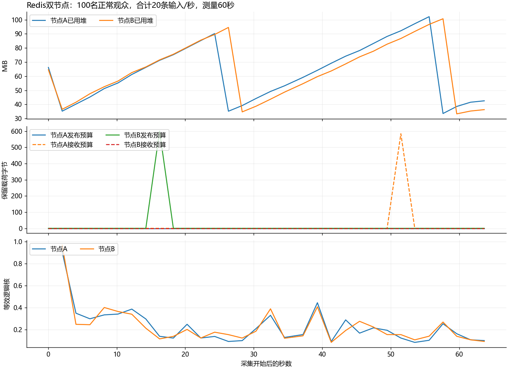
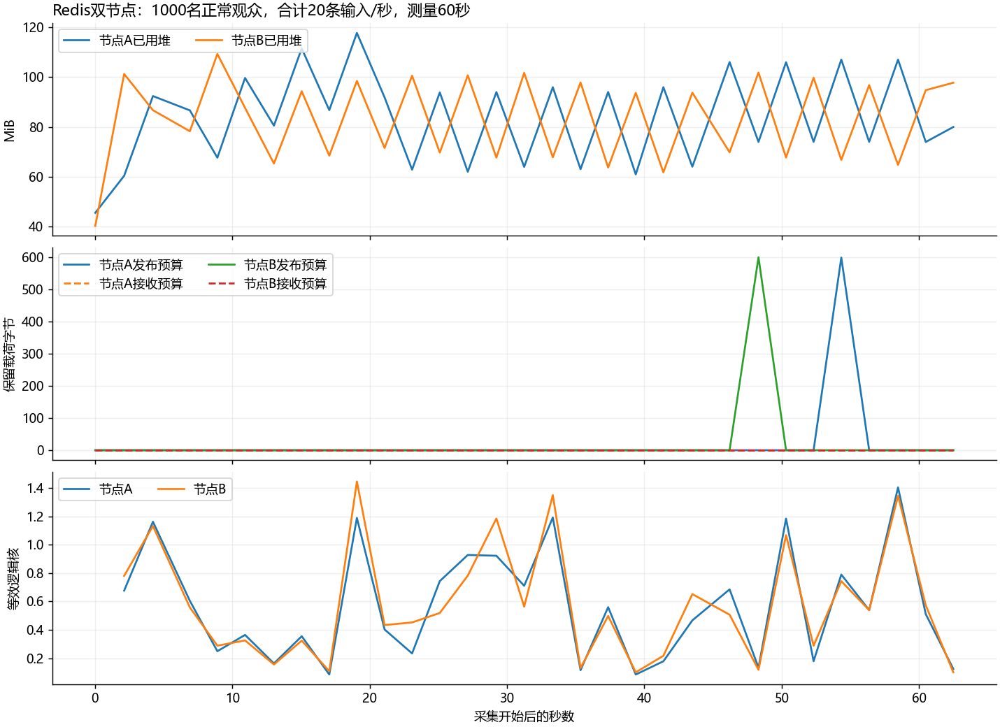

# Redis双节点实现与验收

本轮完成可选Redis Pub/Sub路径：发布、订阅回流后才进入本地房间调度与连接邮箱，来源节点不额外直发，接收节点不再发布。默认local保持原行为，当前未提交推送。

## 单机先回归、再归档

修改前65项Java测试全部通过。旧单机JAR仍为`63C3F3BF6F415E0165FDA5EE710ACDFCA896D8E96981A0539314DD88C4994E28`。完整源码和旧JAR长期保存在本地`.lab-artifacts/baselines/pre-redis-20261026.zip`，不受mvn clean影响；ZIP哈希为`c649f04e7a24d701e92417293ce6e991283f32ccc388d5429ab2b8f3acf12b39`，59个源码/配置/脚本逐字节核对。

[归档索引](redis-implementation/baseline-archive.json)和 [回归记录](redis-implementation/README.md)已保存，原单机实验不覆盖。大二进制仅本地保留，Git保存索引和哈希，尚未提交推送。

## 新路径与边界

`DanmakuHandler → BroadcastIngress → 有界发布FIFO → Redis PUBLISH → 所有订阅节点（含来源）→ 有界接收FIFO → FairRoomDispatcher.acceptBroadcast → 连接邮箱 → 异步写`。

每节点两条桥接队列各256条/1MiB，包含在途；信封最多4KiB，发布等待和Redis操作均限1秒。网络回调只检查长度和非阻塞入队，不解析JSON、遍历房间或发送Socket。发布连接不重放旧命令，订阅恢复须确认后才ready。Redis订阅输出缓冲另设硬/软上限。

event增加UUID messageId、originNodeId，原runId、roomInstanceId、roomSeq表示来源流，接收节点不改写。joined仍表示连接所在节点的本地房间实例。限流/预算按节点生效，不提供集群总50/s额度或全局严格序号。

accepted仅表示Redis确认执行PUBLISH；发布前确定失败为rejected；已尝试但结果无法确认是unknown，不自动重发。订阅/本地队列拒绝单独记录，不把accepted当成观众收到。详细命令和代码路径见 [操作说明](../../CLUSTER.md)。

## 真实网络结果

| 场景 | 实际结果 |
| --- | --- |
| 100正常观众，另加2隔离探针 | 两节点各50人，20/s、60秒，1200条全接受，120000/120000次全收；抽样P50/P95/P99=4/6/7ms，12000样本，最大发送滞后16.73ms |
| 1000正常观众，另加2隔离探针 | 两节点各500人，相同输入，1200000/1200000次全收；抽样P50/P95/P99=19/32/40ms，120000样本，最大发送滞后94.28ms |
| Redis停止并重启 | 前后正常窗口12000/12000次；离线40条全部明确拒绝；ready降0再恢复1，新消息正常，无历史补发 |
| Redis命令真实暂停1800ms | 一次已尝试PUBLISH超过1秒返回unknown，未自动重发；前后12000/12000次。本轮未知输入实际收到0次，仍不能把unknown改成确定失败 |
| 20正常+1慢读+2隔离探针 | 30秒、600条全接受，正常12000/12000次；慢组读34条、19200个TCP字节，最终关闭，未补建 |
| 节点A退出、50人转连B | 原B固定50人重连期3000/3000次；初始及恢复全体各6000/6000次。必达15000/15000，全体实际17510，潜在18000保留，50人全部重新join B |

正常100/1000轮无输入拒绝、unknown、意外读失败、重复、来源流倒序或串房；服务端两节点input/accepted/submitted与客户端逐输入/逐观众计数吻合。初始正常观众不因断线而从正常窗口分母删除。

慢读为缩小SO_RCVBUF、recv约1024B/s，心跳继续；不是暂停页面显示。慢组关闭后正常分母仍完整。该轮节点A有59次输出丢弃和1次写失败，原始结果保留，不宣称全程零错误，也不把包含慢组的submitted当正常接收。

节点退出后A无法取得最终快照，明确标为部分计数，不补写“最终归零”。存活B的16项连接/成员/预算归零。其他轮两节点各16项归零；各正式轮采集错误为0。

## 资源与图表

每节点堆128/256MiB、默认8个异步写提交线程，Redis为Docker的7.4.10。全部进程共享Windows本机资源与回环网络。约2秒目标采样，间隔含HTTP/Docker统计开销；非原子，不是绝对峰值。

千人轮Java平均约0.569/0.578个等效逻辑核，Python约0.534；两节点已用堆采样最大约117.8/109.3MiB、Java工作集约361.0/359.0MiB。工作集包含非堆，不能与堆上限直接比较。Redis CPU/内存原始值保存在resource-summary.json，不代表宿主机总成本。

图表由 [只读分析脚本](redis-implementation/analyze.py.txt)生成，已查看；曲线采到零不说明从未排队，最终清理另查server-after.json。后续客户端加入超时探针、失败归档及固定在线组抽样修正，原source-sha256不改写，verification.json列明后续工具差异。

## 测试、制品与交付范围

- 77项普通Java测试、1项显式真实Redis集成和6项Python统计测试通过。覆盖预算含在途、满/过期、unknown、不重发、坏事件、本地拒绝、来源身份与停机。真实Redis不可连接时集成测试失败，不跳过。
- 真实双页面验证单次跨节点接收、来源标签、Redis暂停产生unknown、换房隔离和375px无横向溢出，见 [页面记录](redis-implementation/ui-verification.json)。
- Redis停止时，交付制品默认local健康UP，k6得到11个joined、3条接受、30/30次真实投递，见 [本地冒烟](redis-implementation/local-smoke.json)。错误redis+direct组合实际非零退出，见 [启动诊断](redis-implementation/invalid-mode-startup.txt)。
- 正式Redis轮制品为`D54AC0E09D5612C5DDAAB03E3378EA9199253DA7E10F37EAAA10B6F900CA9798`。收尾只将页面固定名称改为“房间广播”，交付制品为`DC47737DED23F1353ECF80619FE06A16C87A45D312CB1DD8FBE9D109ACDD3B6F`；全部Java类及依赖逐字节一致，唯一差异是index.html，见 [制品差异证明](redis-implementation/delivery-diff.json)和 [已测制品本地归档](redis-implementation/tested-archive.json)。

这是20/s、60秒双节点及短故障验证，不是30分钟双节点稳态、百万连接或吞吐翻倍证明。没有增加负载均衡、透明浏览器切节点、集群总限流、全局严格顺序、历史持久化、永久去重或exactly-once。队列满/过期、本地房间拒绝由离线控制测试覆盖，不伪称全部做过真实网络压满。

自建8087/8088/8092和专用Redis已停止，用户8084保留。自动审批曾拒绝合并检查命令，后用单独前台检查完成，没有扩大操作范围。后续仍需关键重复与最终演示/简历材料；本轮未提交推送。

后续提交前审查修复了非默认正文上限与超大版本号两个边界，79项Java回归及真实双节点边界验证通过，另见 [审查记录](prepublish-review/README.md)。本报告表格仍属于上文D54测试制品，DC表示当时的页面修订候选；均不冒充审查后新制品的完整规模重测。
