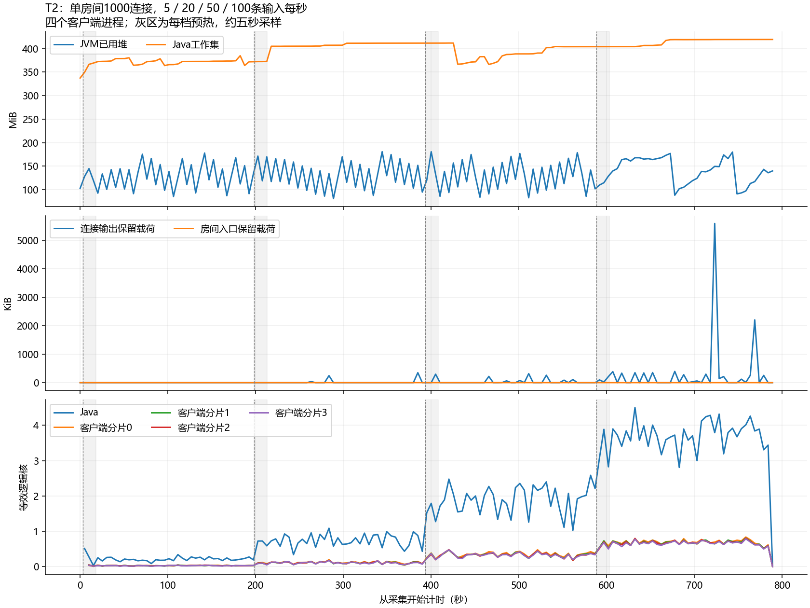

# T2首轮正式吞吐阶梯

**固定1000个观众，5/20/50/100条输入每秒四档各测180秒，测量期31500000/31500000次投递全部收到。** 100/s档测量期1800万次全收，抽样P95/P99为21/51ms。四档均达到本工具参考SLO；这是首轮同机回环记录，不是最大容量或三次重复结论。

## 本次做了什么

新增T2多进程客户端、PowerShell采集入口、13项计数测试和独立归档复核；另外整理了[单条弹幕代码阅读路径](../../MESSAGE_PATH.md)。Java业务代码、默认yml和JAR均未修改，也未提交推送。

四个Python进程各管理250个真实WebSocket观众，只有worker0的观众轮流发送输入；它们都加入同一个房间、同一个Java服务。父进程等待全部join并核对实例后给共同开始时刻，结束时交叉对照逐输入时间戳、序号、接受结果和接收数。每10个观众抽一个测延迟，完整率仍检查全部1000人。直方图合并桶后求总体分位数，不平均各进程P99。

## 环境与负载

- Windows同机回环，JDK25.0.1、Boot3.5.16/Tomcat10.1.55、Python3.14.2、PowerShell7.6.5；服务器和压测端共享CPU/内存。
- 256个UTF-8字节的完整输入JSON，广播添加服务端字段，不能称完整广播256字节。发送者也算观众。
- fair房间调度、buffered容器异步输出、默认8提交线程，`-Xms128m -Xmx256m`。每档预热15秒、测量180秒，最终有限排空7秒；同一批观众不重建、不缩分母。
- 独立8085服务显式`--lab.room-messages-per-second=200`，避免100/s先被项目默认50/s挡住。四档都记录这一固定额度，连接桶仍5/s；不更改默认配置，不移用为T4的50/s结果。
- 固定JAR SHA256：`63C3F3BF6F415E0165FDA5EE710ACDFCA896D8E96981A0539314DD88C4994E28`。55份源码清单与复核时工作区字节相同，仍在未提交工作区。服务JVM先执行工具短轮，正式轮开始前连接和预算为零，计数按前后差值统计。

## 分档结果

| 目标输入/s | 实际输入/s | 测量输入接受/拒绝 | 实际唯一接收/应有投递 | 延迟P50/P95/P99 | 延迟样本数 | 最大发送计划滞后 |
| --- | --- | --- | --- | --- | --- | --- |
| 5 | 4.99989 | 900/0 | 900000/900000 | 4/7/9ms | 90000 | 16.63ms |
| 20 | 19.99983 | 3600/0 | 3600000/3600000 | 4/7/9ms | 360000 | 16.62ms |
| 50 | 49.99950 | 9000/0 | 9000000/9000000 | 4/7/9ms | 900000 | 21.76ms |
| 100 | 100.00039 | 18000/0 | 18000000/18000000 | 6/21/51ms | 1800000 | 311.41ms |

每位观众四档分别收到900/3600/9000/18000条测量弹幕。实际测量时长约180.004/180.002/180.002/179.999秒；末档最大延迟170ms，其余档分别18/22/27ms。没有负延迟或超过120秒的直方图溢出。

含预热共34125条输入全部接受、34125000次唯一接收，与服务端expected/enqueued/submitted增量相同。输入拒绝、正常读失败、重复、乱序、协议错误、输出丢弃、写失败、入口取消、采集错误均为零。进程退出、共同起点和跨进程元数据通过，最后12项连接/房间/预算/任务/名额/在途写Gauge归零。

100/s档发送计划最大滞后311.41ms，小于当前1000ms工具门槛，但不是“每10ms绝对平滑一次”。延迟从实际发送前的时间戳开始，发送前的计划滞后另报；补发形成的短时突发与接收回调调度仍可能影响测得延迟。总接收量包含有限排空，不能把表中需求直接写成每个自然秒均实测完成10万次投递。

## 资源

共157次约五秒采样，覆盖准备、各档预热/测量和排空。已用堆采样最大约180.7MiB，Java工作集最大419.5MiB，JVM活跃线程最大124；应用提交线程活跃采样最大8、异步在途写最大18，不能称整个Java进程只有8线程。

Java平均约1.630等效逻辑核，四个接收进程各约0.299/0.287/0.284/0.279核；CPU口径是累计CPU秒差除以墙钟秒，不是整机CPU百分比。父进程只协调与汇总，CPU平均约0.0008核。分阶段CPU走势见图，不能用整轮平均数代表100/s档的占用。

输出载荷采样最大5719550B，进程输出高水位从预检后的1096172B刷新到12380088B；入口载荷采样最大483B，高水位从964B刷新到2898B。高水位不相减冒充本轮峰值。逻辑预算不含JVM对象、容器和内核内存，采样最大值也不是两次采样之间的绝对峰值。原始GC指标保留于采样，不据此宣称无GC或绝无内存泄漏。

## 工具验证与证据

- 13项离线计数测试通过：去重、确认身份、房间/正文/序号、预热与测量分离、固定观众分母、跨进程时间戳、缺失确认及直方图合并等。
- [100连接短轮](t2-tool-smoke-01/notes.md)：每档测3秒、预热1秒，四档测量期52500次全收，P99=3/2/2/2ms。
- [1000连接预检](t2-tool-1000-01/notes.md)：每档测10秒、预热2秒，测量期1750000次全收，P99=12/9/10/17ms；用于确认工具能产生高档目标输入，不冒充正式窗口。
- [正式原始状态](t2-formal-01/run-status.json)、[客户端汇总](t2-formal-01/client/summary.json)、[独立复核](t2-formal-01/verification.json)、[附加SLO/归零审计](t2-formal-01/additional-audit.json)、[资源明细](t2-formal-01/resource-summary.json)均保存。
- [验证索引与源码快照](t2-verification/README.md)保存实际工具、独立复核和绘图代码；运行方法见 [T2说明](../../THROUGHPUT.md)。没有为了这次工具变更重跑或虚称新增Java测试。

本次压测端从单进程改为多进程，且房间额度为200/s，因此不把本表与旧T5的P99差直接当作后端优化收益。100/s档已通过一次只说明所测范围内达到目标，没有测到最高边界；T6重连、关键对照重复、完整P0回归与交付材料仍待完成。自建8085服务在复核后停止，用户8084服务保留。

后续进度：本报告完成之后，[T6的100/500人重连首轮](t6-report.md)也已通过。上文“尚待T6”保留当时范围；关键对照重复与完整P0交付仍待完成，本次未修改Java或JAR。
