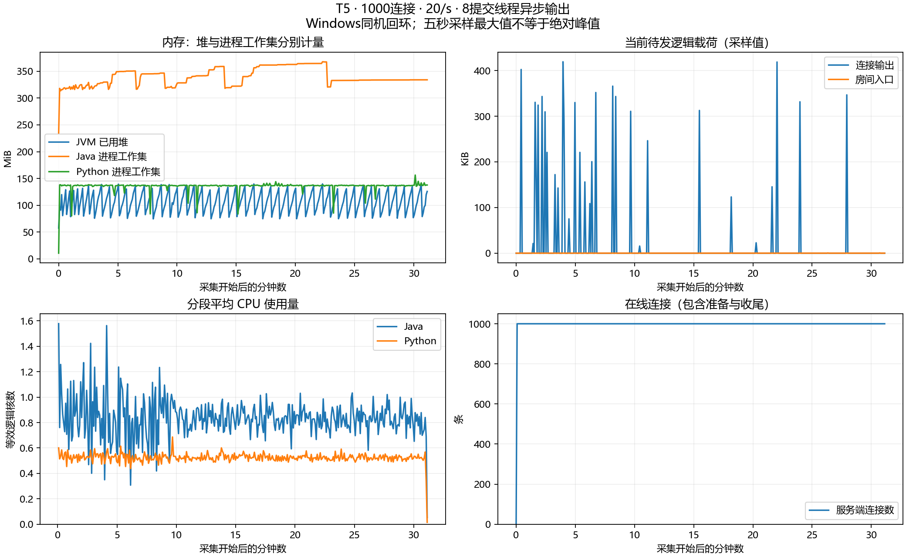

# 用户手动完成的新异步版本30分钟稳态测试

本轮正式T5复核通过。1000个观众全部正常读取，每秒20条输入，预热60秒、正式测量1800秒。使用fair房间调度、buffered异步输出、默认8个共享提交线程，Java最大堆256MiB；服务启动命令保存在server-command.txt。

## 接收结果怎么理解

- 每个观众测量期都收到36000条：1000个人合计36000000/36000000次唯一接收。
- 预热另收1200000次；含预热的服务端expected/enqueued/submitted均为37200000，与客户端总接收相同。
- 漏收、重复、乱序、协议错误、异常断连、输入拒绝、输出丢弃、写失败、房间入口取消均为零。
- 抽样3600000次延迟：P50=16ms、P95=28ms、P99=35ms、最大104ms。这里是客户端发出到模拟观众读到消息的端到端时间，不是单独服务端处理时间。
- 实际测量1800.002秒，实际输入19.99998/s，最大发送计划滞后78.97ms。采集无错误、子进程正常退出且日志保存完整；结束后连接、两层预算、连接名额和在途写归零。

## 制品与资源

JAR SHA256为`63C3F3BF6F415E0165FDA5EE710ACDFCA896D8E96981A0539314DD88C4994E28`，与本日已通过15分钟混合慢读的异步制品相同；没有使用旧32线程候选配置。完整输入JSON为256个UTF-8字节，广播添加服务端字段，不能把广播大小也写成256字节。

约5秒采样371次，覆盖准备、预热、测量和排空。已用堆采样最大约139.7MiB，Java工作集最大约367.9MiB，Java/Python平均约0.834/0.524个等效逻辑核。当前输出载荷采样最大429308B，进程高水位922504B；入口高水位970B。应用提交线程活跃数采样最大8、在途写最大15；采样最大不是绝对峰值，逻辑载荷预算不等于进程内存。

完整明细见resource-summary.json，曲线由本日writer-fix-verification中的已归档Matplotlib脚本根据samples.jsonl生成。图中最后一份五秒采样可能早于关闭收尾，最终归零以server-after.json和run-status.json为准。GC端点在首次采样尚未登记，因此派生脚本未直接计算完整窗口GC差值，不补造GC数据。



## 怎样独立复核

从仓库根目录执行：

```powershell
python scripts/tests/longrun-summary.test.py docs/results/2026-10-26/t5-094730 --formal
```

输出为`PASS FORMAL`。原始config、command、environment、客户端逐观众统计、服务端前后与时序、源码/JAR哈希和进程状态均保留原样；verification.json记录本轮新增的证据与源码核对。

这证明本机、这个版本、上述负载下的一轮30分钟稳态通过，不证明最大容量或公网表现。新版完整T4、关键对照三次重复、Linux/异机及完整P0清单仍需继续；当前未提交推送。
