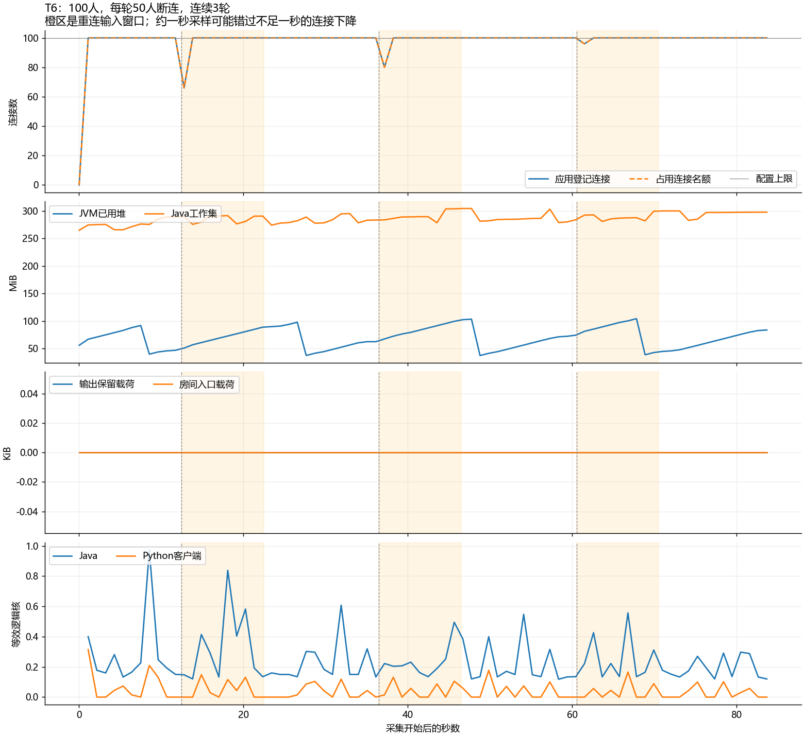
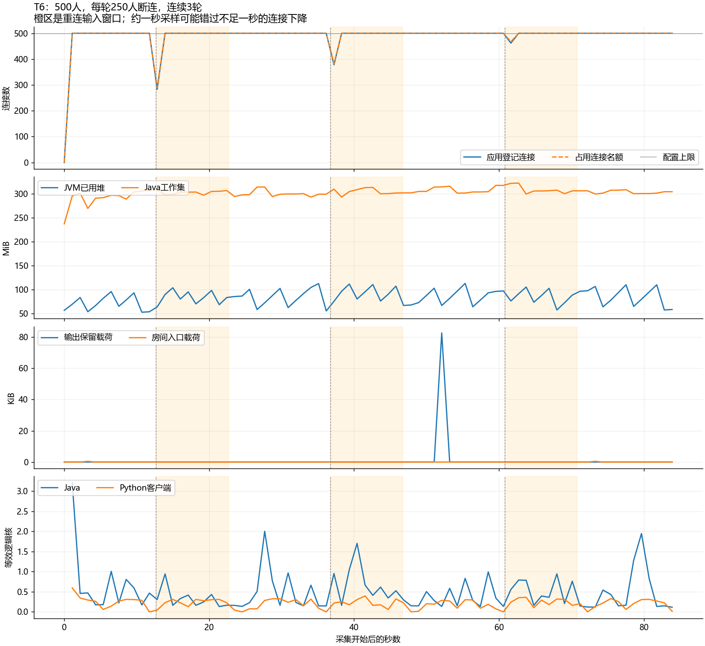

# T6：100/500连接突发重连首轮结果

100连接验证及500连接补充验证均通过：每轮关闭一半观众的TCP，按退避加随机抖动重新连接、加入同一房间。始终在线观众持续收齐，恢复后的全体观众也收齐；旧名额回收，新的connectionId不重复。Java代码、yml和JAR未修改。

## 1. 主要结果

| 项目 | 100人，50人每轮重连 | 500人，250人每轮重连 |
| --- | --- | --- |
| 连续断连/恢复轮次 | 3 | 3 |
| 每轮输入窗口 | 10秒重连期 + 10秒恢复期 | 同左 |
| 加上最初10秒，总输入 | 1400条，全部接受 | 1400条，全部接受 |
| 固定在线组在三个重连窗口 | 30000/30000次 | 150000/150000次 |
| 初始及三个恢复窗口全员 | 80000/80000次 | 400000/400000次 |
| 合计必达投递 | 110000/110000次 | 550000/550000次 |
| 全体实际接收，含提前恢复者 | 138440次 | 692173次 |
| 初始人数×全部输入的潜在需求 | 140000次 | 700000次 |
| 三轮全员重新join耗时 | 999.1 / 1005.7 / 998.8ms | 1029.9 / 1006.3 / 1017.1ms |
| 各重连窗口固定在线组抽样P99 | 3 / 3 / 3ms | 10 / 11 / 10ms |
| 各恢复窗口全体抽样P99 | 3 / 4 / 3ms | 16 / 15 / 16ms |
| 实际输入范围 | 19.972～19.993条/秒 | 19.972～19.999条/秒 |
| 最大发送计划滞后 | 16.50ms | 23.99ms |
| 全新连接ID总数 | 250 | 1250 |
| 满额探针真实1013拒绝 | 9次 | 9次 |
| 意外读失败 / 重复 / 乱序 | 0 / 0 / 0 | 0 / 0 / 0 |
| 采集错误 / 最终未清理Gauge | 0 / 0 | 0 / 0 |

“必达”110000/550000不是缩减正常观众分母。重连窗口只要求始终在线的一半收齐；离线的一半不要求历史重放，但其潜在需求仍保留。恢复后全部初始观众都重新加入必达组。逐观众逐条去重，不能用其他人的额外接收抵消漏收。

## 2. 准入和重试覆盖

服务分别显式配置应用上限100、500。初始满额后，3个额外探针各真实尝试3次，均收到关闭帧1013，对应服务端`lab.connections.rejected`增量9。它们没有成为房间观众，TCP EOF、超时不能冒充准入拒绝。

探针真实走过1、2、4秒等待上限，每次随机等待和结果保存在`client/summary.json`的retries。主重连组在两轮实验中均首次尝试成功，等待上限1秒，因此全员约1秒恢复。**未实测主组连续六次失败后的恢复，也未实测网络黑洞。** 8/16/30秒上限及失败分支有单元测试，不能与网络实测混为一谈。

固定在线组从不重建；受影响组每轮新建TCP/WebSocket并join，connectionId与旧ID不同。脚本直接关闭客户端socket，不发WebSocket关闭帧，服务器可感知TCP关闭；不同于拔网线后长时间没有FIN。Python模拟与页面相同的退避规则，没有驱动浏览器app.js。

## 3. 计数、资源与曲线

两组各输入并接受1400条，弹幕拒绝为零；服务端expected/enqueued/submitted分别与全体实际接收138440、692173一致。本轮恰好没有写失败、输出丢弃或入口丢弃。这个相等不是动态成员测试的通用前提：计划断开时可能有旧连接在途写，今后出现时应保留，并以固定在线/恢复窗口真实接收判断影响。

| 约一秒资源采样 | 100人 | 500人 |
| --- | --- | --- |
| 样本数 | 80 | 80 |
| JVM已用堆采样最大值 | 104.3MiB | 113.0MiB |
| Java工作集采样最大值 | 304.4MiB | 321.9MiB |
| Python工作集采样最大值 | 43.2MiB | 74.6MiB |
| Java平均等效逻辑核 | 0.243 | 0.507 |
| Python平均等效逻辑核 | 0.041 | 0.211 |
| JVM线程采样最大值 | 96 | 124 |
| 连接 / 名额采样最大值 | 100 / 100 | 500 / 500 |
| 输出载荷生命周期高水位，前→后 | 48103→48204字节 | 0→241104字节 |

100人服务先跑过短轮，高水位不能相减当本轮峰值；500人服务为新进程。输出预算只计保留载荷，不是总内存。工作集包含非堆、线程栈等，可能超过256MiB堆上限。

采样是顺序HTTP快照，可能错过不足一秒的连接下降、队列与在途写。100人队列采样恰好全为零，但生命周期高水位非零，不能说没有排队。图在客户端结束时停止；最终归零由两秒后server-after.json另行核对。

两组结束后12项Gauge均为零：连接、房间、输出字节/消息/名额/任务/活跃提交线程/在途写、入口字节/消息/房间/就绪队列。自建8086在身份和归零确认后停止，用户原8084服务保留。

曲线由Matplotlib读取原始samples.jsonl生成，代码在 [验证目录](t6-verification/README.md)。橙区是重连输入窗口，灰虚线是计划断连；没有补点或平滑数据。

## 4. 证据与范围

- [100人原始汇总](t6-formal-100-01/client/summary.json)、[独立验证](t6-formal-100-01/verification.json)、[资源摘要](t6-formal-100-01/resource-summary.json)。
- [500人原始汇总](t6-scale-500-01/client/summary.json)、[独立验证](t6-scale-500-01/verification.json)、[资源摘要](t6-scale-500-01/resource-summary.json)。
- [100人工具短轮](t6-tool-100-01/client/summary.json)：必达10000/10000次，独立复核通过。
- [操作与统计说明](../../RECONNECT.md)、[工具快照与复核命令](t6-verification/README.md)。

制品SHA256：`63C3F3BF6F415E0165FDA5EE710ACDFCA896D8E96981A0539314DD88C4994E28`。默认8提交线程、fair+buffered、房间额度50/s、单连接5/s、堆128/256MiB。同机Windows回环，Python单事件循环，没有异机延迟或浏览器渲染。

T6首轮目标及500人补充已完成。新增客户端、采集器、12项单元测试、独立复核与文档，未修改Java或重建JAR。工作区既有未提交业务改动属于之前阶段，本轮也未提交推送。关键对照至少三次重复、完整P0回归和演示/简历材料仍待完成，不宣称任意重连规模或最大容量。
