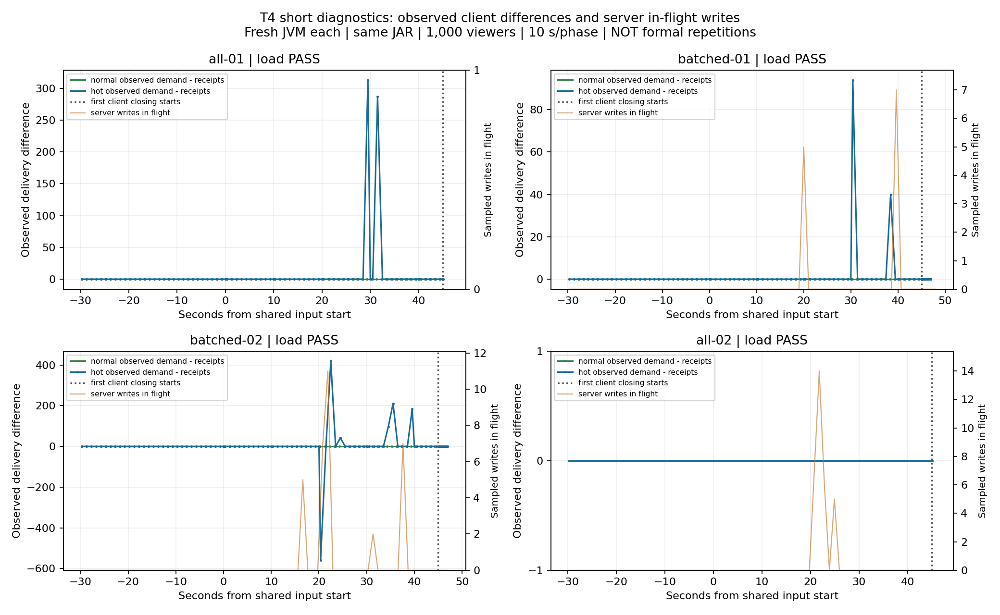

# T4短诊断接续：工具可审计，旧失败尚未复现

2026-10-27晚间，接续已批准的短场景方案。**诊断模式、失败证据和固定四轮实测完成；没有重跑正式长测，没有确认旧问题的根因，也没有把三对正式T4勾选完成。**Java业务、application.yml和发布JAR均未改变；当前工具、报告与结果未提交推送。

## 这次补上的观测

默认模式保留原有收发、有限排空与验收门槛。显式`Diagnostic`仅允许每阶段最多10秒，按“停止新增发送→继续接收结算→请求关闭→观察关闭→最终结算”输出每秒累计值和生命周期事件。支持受控关闭批次，保存首个错误与首个关闭原因，终态之后忽略迟到的统计回调。

服务端约每秒采样，保留每份快照的起止时间、进程PID和采集错误。子进程失败后也尽力写计数对账与12项清理Gauge，再抛原错误；缺失保留null或错误，不能补0。新审计器区分`evidenceComplete`与`passed`：可读的失败证据仍然失败。

运行说明与参数见[操作文档](../../HOTSPOT_DIAGNOSTIC.md)。所有场景同机回环，JAR SHA-256为`BC5652880AD8FA34B903B7F6350E292D090FA914C85456879243082A38F43F65`；运行源码27个文件与发布源码归档一致。Java82项与真实Redis1项是此前发布检查，本次没有冒称重新执行。

## 实际执行结果

### 60连接及失败门槛

- [60连接诊断](t4-diagnostic-resume-smoke/suite-status.json)：每阶段3秒，普通2×5人、热点50人；全关20690/20690，分批20640/20640，均通过时间线、计数与12项清理。
- [受控停顿](t4-diagnostic-resume-injected/stall-01/load/diagnostic-audit.json)：两个k6进程各显式阻塞自身VU 1.1秒一次，热点计划发送最大滞后1060ms，原`max<1000`门槛失败，热点k6退出99；普通610ms未越门槛。20640/20640虽全收，仍保留`passed=false`。失败轮计数对账、原始退出码、终态与12项清理完整，证明失败归档路径实际执行。
- [默认路径实网回归](t4-diagnostic-default-regression/verified-summary.json)：未开启诊断，direct/fair各60连接、每阶段2秒，真实14560/14560与14610/14610次全收，独立检查通过。房间令牌桶边界会影响实际accepted数，每轮按自身接受量形成应收分母。

### 固定四次千连接短对照

[原始套件](t4-diagnostic-resume-1000/suite-config.json)、[逐轮状态](t4-diagnostic-resume-1000/suite-status.json)、[派生统计](t4-diagnostic-resume-1000/analysis.json)。每次新JVM，fair+buffered、8提交线程、同一JAR和工具源码，按全关/分批/分批/全关预先固定次序执行，无自动重试或挑选。四轮各1000人，普通10×50人、各2/s，热点500人，四阶段尝试0/20/100/200条/s，每阶段10秒，共30秒加入准备、5秒排空。分批每次25个、间隔100ms；默认房间限流50/s未调整。

| 尝试 | accepted / rejected | 实际接收 / 应收 | 热点最大计划发送滞后 | 关闭耗时：普通 / 热点 | 结果 |
| --- | --- | --- | --- | --- | --- |
| 全关1 | 2048 / 1952 | 664000 / 664000 | 248ms | 53 / 59ms | 通过 |
| 分批1 | 2049 / 1951 | 664500 / 664500 | 115ms | 1914 / 1916ms | 通过 |
| 分批2 | 2049 / 1951 | 664500 / 664500 | 159ms | 1916 / 1916ms | 通过 |
| 全关2 | 2050 / 1950 | 665000 / 665000 | 121ms | 49 / 47ms | 通过 |

四轮合计**2658000/2658000次真实接收**。普通房间每阶段逐房间P99中最慢值，本轮未超过31.02ms；不是把多房间分位数合并或平均后的总体P99。各轮无客户端错误、重复、串房或来源流倒序，服务端计数匹配、采集错误为0，12项预算最终归零；全部自建JVM和防自动休眠请求已清理。

每个客户端进程开始请求关闭时，累计接收与观测到的接受需求相等。全关约几十毫秒，分批约1.9秒是人为错开20个批次的结果，不能称为分批提高了关闭速度。



横轴0为共同输入起点，负数是加入准备；虚线为首次开始请求关闭。左轴为客户端累计接受需求减真实接收，右轴为服务端采样在途写。点之间的连线只辅助读图，不能当作精确连续曲线。分批2中出现负差，是accepted回复晚于部分广播回调的合法观测次序，不是负的服务端队列。

客户端差值与服务端队列不是同一量。比如全关2客户端每秒采样差值最大为0，但同轮服务端输出保留载荷采样达到1561809字节、在途写达到14条；它们是不同时间、不同环节的观察，不能拿前者推断后者一直为空。全关1采样在途写最大0也不表示没有发生过写。

## 能得出的结论与不能得出的结论

这次能还原停止输入、接收追上、关闭请求和关闭回调的先后；成功与刻意失败轮都可独立核对。四次短诊断没有重现此前1033ms正式发送滞后或大量关闭握手拥堵，因此**没有证据把原失败归因于一次性关闭，也不能声称已修复服务端或工具的原问题**。同机负载、预热、诊断采集频率及诊断收尾与旧轮不同，不直接混算优化收益。

本轮不是三对180秒正式T4，不替代T3/T5重复。后续若恢复正式负载仍需保留门槛、固定次数和全部失败；若再次出现停顿，应先利用现有时间线确定它发生在请求关闭前还是后，再选择分离热点发送/接收或容器关闭路径的单因素实验。

## 回归、修补与制品绑定

- 51项Python（含7项日志与时间线损坏/失败审计回归）、12项Node状态机测试、5项指标、5项子进程回归实际通过。Node虚拟Socket验证分支与定时器，不算网络成绩。
- 连接建立边界夹具原先把10秒打开延迟误当成60秒加入截止，已改为明确在CONNECTING状态注入错误；补齐构造失败、关闭回调缺失与有限收尾。
- 超时结算后迟到close回调曾在`settled`后追加两条事件，新增回归先失败，补终态保护后通过。这个补丁在四轮诊断后完成，四轮源文件哈希绑定各自当时版本；随后默认路径实网回归验证最终工具正常收发，迟到失败分支由上述定向回归覆盖。未把旧实验工具哈希改成最终工具哈希。
- 首个错误、最终缺失与终态日志同步保存，避免错误发生在终态之后才追加。失败后对账补齐不改变原来的失败退出语义。

复核与生成派生图：

```powershell
python -X utf8 scripts/tests/hotspot-diagnostic-summary.py docs/results/2026-10-27/t4-diagnostic-resume-injected/stall-01/load --evidence-only
python -X utf8 docs/results/2026-10-27/analyze-t4-diagnostic.py.txt docs/results/2026-10-27/t4-diagnostic-resume-1000
```

分析脚本只写派生统计和图，不改原始日志、计数、源码/JAR哈希或失败状态。历史诊断见[此前复测报告](t4-repeat-report.md)。
