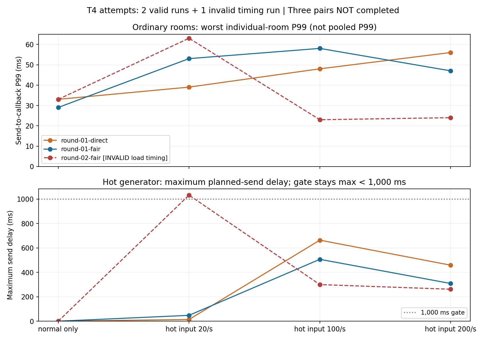

# T4复测与失败诊断：三组尚未完成

日期：2026-10-27。最终发布制品完成一对有效正式对照；第二轮fair虽收齐消息，但工具发送滞后门槛失败，批次停止。三组尚未完成，不能勾选通过。Java业务、配置和发布JAR未改变，当前改动未提交推送。

## 测的区别

direct与fair都启用buffered异步输出、8个提交线程。direct在处理输入的线程里一次遍历整份房间成员快照；fair先进入有界房间队列，由单个调度线程按最多4条输入或64份观众投递轮转。二者最终都投递到本地连接邮箱；这不是同步写与异步写的对照，也没有启用Redis。

统一JAR为`BC5652880AD8FA34B903B7F6350E292D090FA914C85456879243082A38F43F65`，运行源码27个文件与发布归档一致。Java业务、yml和JAR未修改；新增重复编排、实际制品路径记录与复核工具。每次新建JVM，使用`-Xms128m -Xmx256m`，独立端口8085。

10个普通房间各50人、各2条输入/s；热点房间500人，共1000观众（含发送者）。四阶段热点尝试0/20/100/200条/s，各180秒，前置30秒加入准备、末尾5秒排空。房间额度默认50/s，连接额度5/s；每个输入JSON为256个UTF-8字节。normal/hot各一个k6进程，对齐共同绝对起点，抽样每10个观众取一个，完整接收检查则覆盖所有观众。

计划三对先后为direct→fair、fair→direct、direct→fair；实际只执行首对和第二轮fair，后三次未启动。轮换顺序可以观察部分顺序影响，不是完全平衡的随机实验。Windows同机回环，Java、两个k6及日常程序共享主机；不能当作公网、独占服务器或最高容量成绩。

## 结果与复核

原始批次：[t4-repeats-formal-02](t4-repeats-formal-02/README.md)。[离线审计](t4-repeats-formal-02/attempt-audit.json)确认三次均按实际accepted数收齐，服务端计数相符、最终12项Gauge归零；仍保留第三次k6退出99和批次false。严格三组校验器会拒绝此批，未生成任何冒充通过的`verified-summary.json`。

| 尝试 | accepted / rejected | 实际接收 / 应收 | 普通房间各阶段最慢房间P99：0/20/100/200热点输入（ms） | 状态 |
| --- | --- | --- | --- | --- |
| 第一轮direct | 36053 / 35947 | 11546500 / 11546500 | 33.01 / 39.01 / 48 / 56 | 有效 |
| 第一轮fair | 36049 / 35951 | 11544500 / 11544500 | 29.01 / 53 / 58.02 / 47 | 有效 |
| 第二轮fair | 36049 / 35951 | 11544500 / 11544500 | 33 / 63.01 / 23 / 24 | 工具发送滞后1033ms，未通过 |

有效一对合计23091000次全收，但fair并未各阶段全面更快。第三次后两阶段看起来较快，也不能忽略该轮已失败的工具门槛、把它挑成优化成绩。不能平均多个P99后称为总体P99，也不能把某阶段“最慢房间P99”称为所有观众合并P99。



第一对每轮约5秒采样150次。direct/fair已用堆采样最大133.9/134.6MiB，Java工作集348.7/346.0MiB，输出载荷高水位约6.85/5.76MiB；Java平均约0.736/0.750个等效逻辑核，热点k6约1.492/1.381核，普通k6约0.131/0.177核。不同进程仍共享硬件；这些是对应时段累计CPU差或采样值，不是主机CPU百分比、绝对内存峰值或单机容量上界。

```powershell
pwsh -NoProfile -File scripts/run/repeat-hotspot.ps1 -Rounds 3 -PhaseSeconds 180 -OutputDirectory docs/results/2026-10-27/t4-repeats-formal-02
python -X utf8 scripts/tests/repeat-hotspot-summary.test.py docs/results/2026-10-27/t4-repeats-formal-02 --formal
python -X utf8 docs/results/2026-10-27/analyze-t4-repeats.py.txt docs/results/2026-10-27/t4-repeats-formal-02
```

此目录已存在，复现时必须换一个新目录，不能覆盖。上面的命令是后续完整复现入口，不表示当前已通过。批次中的三次使用同一不可变JAR和工具源码；每次保存命令参数、环境、运行源码哈希、制品哈希、两个客户端接收报告、服务器计数和资源时序。完整批次复核还会检查启动PID等于采样JVM、六轮无重叠、12项最终预算归零、自建JVM退出。

热点输入超过50/s而被明确拒绝是预期行为。只用已接受消息形成观众应收分母，拒绝消息不要求收到。客户端解析真实弹幕后才计接收；服务端accepted、入队、写完成均不替代接收。`hotMaxSendLagMs`衡量计划发送到实际发送tick的滞后；端到端`latencyMs`从该tick的`sentAt`计至客户端接收回调，含客户端接收处理等待，**不包含发送之前的计划滞后**。两者须一起看，不能把任一项全部归因于Java。

## 中断与工具验证

- [首批中断](t4-repeats-formal-01/README.md)：direct完整通过，fair约70秒后遇到机器睡眠，整批失败保留；不拼接成功轮凑三组。
- `t4-repeat-tool-01`使用过少热点发送者，被客户端参数校验拒绝，编排正确停止并保留失败。
- `t4-repeat-tool-02`验证原始编排；`t4-repeat-tool-03`验证防自动休眠与实际JDK启动路径，各direct/fair均14610/14610次全收。短轮只证明工具路径，不计入正式重复。
- 防休眠使用临时Windows SystemRequired句柄，不修改电源计划，不要求屏幕常亮；结束释放。手动睡眠、合盖与重启仍会使实验无效。管理员命令`powercfg /requests`未获权限，未把它计为成功验证；原生申请/释放及重复释放已实际执行。

## 诊断试验与当前未解问题

1. `t4-counter-before`：原脚本，1000观众、每阶段10秒的短轮，热点工具不能维持计划，出现3次指标超时。这是不同窗口的诊断，不能替代180秒正式阶段。
2. `t4-counter-after`：只把接收Counter改为结束时汇总，逐份校验与延迟采样仍保留；同样失败，未证明有效，已撤回。试验代码保存在该目录。现场`thread-dump.txt`显示大量Tomcat工作线程在`WsSession.onClose → sendCloseMessage → acquireMessagePartInProgressSemaphore → Thread.yield`，共享发送线程空闲；堆约98.5MiB。线程转储本身会扰动时序，此轮只用于诊断。
3. `t4-heartbeat-stagger`：恢复原计数，只错开十组心跳，单连接仍15秒一次；仍失败，也已撤回。不能把任一试验写成修复。

短轮观测支持“出现积压后，关闭握手占用了许多容器处理线程，采集也受到影响”，尚不能证明这就是正式轮1033ms的起因。短轮没有与180秒阶段相同的预热过程；工具拥堵、容器关闭路径和共享主机调度仍需进一步分离。下一步应先建立针对热点发送滞后/批量关闭的可重复短场景，补接收积压与关闭时序，再决定是否拆分热点客户端进程或修改服务；暂不继续无控制地重跑长批次、挑选通过结果。

当前原始`hotspot.js`已恢复SHA-256 `55AF9F9C2C58163C0F29A74A2A20D7883C9B9BEDAD2F20C284A4146DEDE07C2E`。恢复后的`t4-repeat-final-tool`两模式各14610/14610次全收，严格短轮复核通过，仅表示编排可用。

最终工具回归为44项Python、5项指标和5项子进程场景。子进程测试的半秒启动假设曾失败，诊断保存在`process-evidence-fixture-failure`；现用子进程flush后写出的就绪信号触发回调故障，修复后五场景通过，生产捕获模块未改。实验自建JVM和防休眠请求均已清理，不停止其他工程的Java进程。

T4重复不能替代T3/T5的独立重复，也不能证明5000/10000连接、跨主机或Redis长稳态。完整项目验收及最终演示材料另行跟踪。

当天晚间后续：按批准方案新增默认关闭的诊断模式，固定四轮千连接短对照和受控失败归档已执行，见[接续报告](t4-diagnostic-report.md)。上方“脚本已恢复”描述的是前一轮撤回两项无效试改时的状态；当前客户端另有可选诊断代码，Java业务/JAR仍未改。短诊断未复现旧问题，三对正式验收继续保留未完成。
