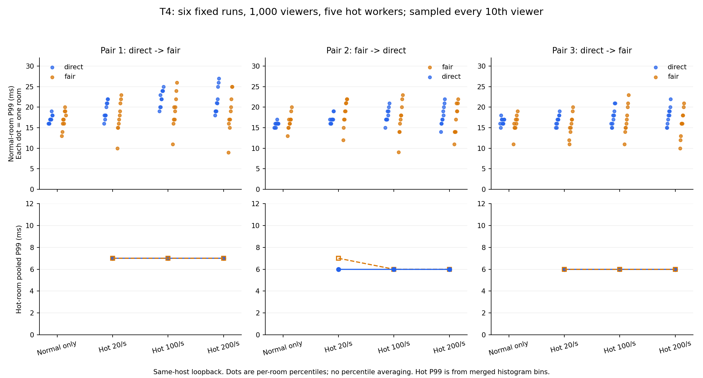
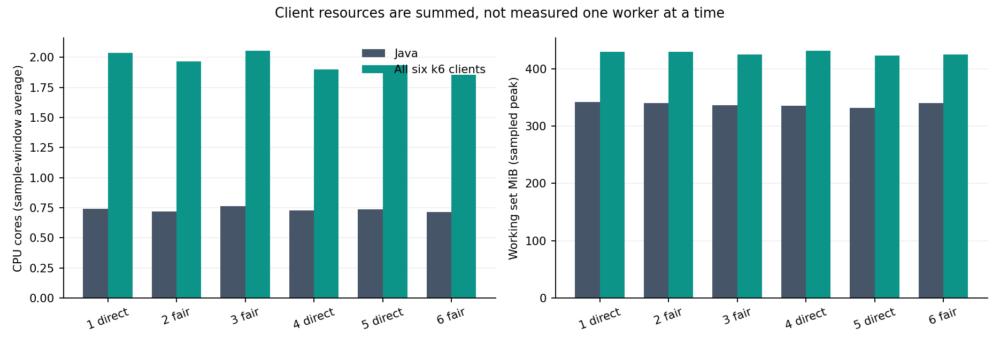

# T4三对正式重复完成

2026-10-28完成复核。实验于北京时间2026-10-27晚间结束：**六轮全部通过，合计69267000/69267000次真实投递收齐，三对正式T4完成。** 本批没有失败正式轮、没有重试、没有拼接历史成功轮。业务源码、配置和JAR保持原发布版本；本轮没有提交、推送或合并。

这次完成的是T4工具验收与三对正式重复。T3/T5关键重复、Linux/异机、完整P0交付和最终演示材料仍分别跟踪；不能一起勾选。

## 运行条件

- 固定顺序：direct→fair、fair→direct、direct→fair，每轮独立JVM和新连接，顺序执行。
- JAR SHA-256：`BC5652880AD8FA34B903B7F6350E292D090FA914C85456879243082A38F43F65`。
- 单Java实例、local模式、8085、buffered输出、8个提交线程，`-Xms128m -Xmx256m`。没有Redis参与，没有调整房间限流。
- 普通房间10×50人，每房间2条输入/s；热点房间500人，由5个k6进程各100人模拟，另一个k6进程负责500名普通观众。
- 热点全局输入为0/20/100/200条/s，每阶段180秒；准备30秒、排空5秒、一次性请求关闭。输入请求固定256个UTF-8字节。
- 6轮输入窗口共72分钟，正式阶段含准备和收尾约76.58分钟；没有用缩短窗口或并行执行代替重复。
- Windows同机回环，Java、全部压测器和其他日常程序共享主机，不是独立服务器或公网成绩。

源命令、环境和完整参数见[批次命令](batch-command.json)、[固定计划](fixed-plan.json)及每轮server-launch.json。所有轮次源码与制品一致。

## 六轮结果

普通房间P99一列列出四阶段各自**最慢房间的P99**，不是平均P99或合并总体P99。热点P99使用每10个全局观众编号抽1人的固定毫秒桶合并计算。

| 对/执行次序 | 模式 | 实收/应收 | 所有进程最大发送滞后ms | 普通房间P99四阶段最大值ms | 热点20/100/200合并P99 ms |
|---|---|---:|---:|---|---|
| 1-1 | direct | 11544500/11544500 | 24 | 19 / 22.01 / 25.01 / 27 | 7 / 7 / 7 |
| 1-2 | fair | 11544500/11544500 | 28 | 20 / 23 / 26 / 25 | 7 / 7 / 7 |
| 2-1 | fair | 11544500/11544500 | 28 | 20 / 22 / 23 / 22 | 7 / 6 / 6 |
| 2-2 | direct | 11544500/11544500 | 22 | 17 / 19 / 21 / 22 | 6 / 6 / 6 |
| 3-1 | direct | 11544500/11544500 | 21 | 18 / 19 / 21 / 22 | 6 / 6 / 6 |
| 3-2 | fair | 11544500/11544500 | 22 | 19 / 20 / 23 / 21 | 6 / 6 / 6 |

每轮尝试72000条输入，接受36049条、按房间额度拒绝35951条；普通房间拒绝为0。热点全局接受21649条、乘500名观众形成10824500次需求，普通房间另有720000次，合计11544500次。所有观众位图逐项收齐，无重复、串房、乱序、未知确认或异常拒绝；服务端input/accepted/rejected、expected/enqueued/submitted匹配，写失败、输出丢弃和房间调度丢弃为0。

热点实际输入约19.99993～20、99.99967～100、199.99933～200条/s，均在目标±5%内。热点进程最大计划发送滞后13～15ms、最大定时器漂移16～28ms；普通进程的发送滞后也纳入表中“所有进程最大值”。正式模式沿用旧普通客户端，未导出其定时器漂移，因此该值保留null，没有补0宣称全客户端漂移上限。



上排每个点是一间普通房间的P99；蓝色direct、橙色fair。下排是热点合并直方图P99，相同点重合。fair在部分房间/阶段较低，也有较高情况；本场景没有证明fair普遍更快，不能把调度机制直接写成性能提升。

## 资源与清理



输入期采样端点覆盖约715～719秒，Java平均约0.71～0.76个核，全部6个k6合计约1.86～2.06个核。工作集采样峰值Java约332～342MiB、全部k6合计约423～432MiB。工作集包含非堆，不与256MiB堆上限混为一项；图中CPU是采样窗口平均，工作集是采样峰值，不是绝对峰值。

输出保留载荷采样峰值约158183～207000字节，在途写采样最大8～20条。fair房间层保留字节采样最大498～3904，服务端房间字节高水位三轮均为5400字节；采到0不代表从未排队。指标按顺序读取，不是原子快照，不能反推某一时刻字节数与条数的严格对应。

各轮resources.json保留准备/输入/排空/关闭分段；原前缀聚合可能含同前缀Counter/Timer，本报告的队列结果只引用formal-summary.json中明确列出的Gauge，不把Timer计数称作队列长度。CPU统计合计所有k6进程，不因分进程而只展示某一个工作进程占用。

每轮排空后在有限10秒窗口检查12项Gauge，全为0；13个自建JVM（含前置7轮）均退出，实际PID各不相同、轮次不重叠，8085无残留监听。防自动休眠句柄已释放，没有停止用户其他服务。

## 先修复与先验收

- 已修复原型ThreadJob默认并发5导致第六个客户端排队、10ms计时检查漏末尾输入槽、重复先被归类乱序；新负载客户端在1/5双方使用相同协议和实现。
- 本次接续修复报告门槛措辞与轮间暂停标记检查，线程数显式固定8；先复现失败、再回归通过，红/绿记录保留在checks/。暂停只阻止后续轮创建JVM，当前轮正常收尾。
- 新鲜执行70项Python、19项Node、5项指标、5项子进程、4项正式门控检查；默认direct/fair与历史短诊断证据只读复核通过。没有把此前82项Java和1项Redis集成冒称本次重跑。
- 本批1/5进程60观众冒烟各20690/20690；仅hot-0在20/s阶段暂停1.5秒，滞后1252ms触发原门槛，仍完整归档20690/20690并保留失败，未算性能成绩。
- 本批固定1/5/5/1千连接短轮全部通过，各664500/664500；单进程热点最大滞后544/392ms、100/s阶段合并P99为519/427ms，五进程相应P99为8/7ms。此前[独立短批次](../t4-workers-short-01/notes.md)两次单进程超过门槛失败，记录保留。单进程滞后有波动，不因新一批通过就宣称旧问题不存在。

五进程工具在三对正式重复中维持了负载，本场景投递完整性有支持。新客户端比历史脚本多了校验、接收证明，计时开销也不同；本轮没有完整解释旧1033ms/关闭拥堵的所有原因，没有修改Java业务，不宣称旧问题根因全部定位、业务性能提升或容量翻倍。

## 证据入口与复现

- [最终复核](final-verification.json)：重新合并6轮独立台账和逐观众位图，69267000/69267000；617个原始索引文件、66份压缩日志字节核对，89个冻结文件未变，27个运行文件与发布源码归档一致。
- [正式逐轮数据](formal-summary.json)：实际速率、逐房间P99、热点合并分位数、资源及队列Gauge。
- [完整批次状态](batch-status.json)及[自动报告](report.md)：包含全部前置尝试与失败，正式6/6，不存在未执行项。
- 每轮evidence-index.json列原始目录、大小和SHA-256。接收位图、逐输入确认/元数据在k6-stderr.txt及字节一致的.gz；大文件保存在忽略的.lab-artifacts目录，须与结果索引一起保存。

```powershell
cd D:\coding\DanmakuLab
pwsh -NoProfile -File scripts/run/hotspot-workers.ps1 -RunFormal -OutputDirectory docs/results/日期/新的批次目录
python -X utf8 docs/results/2026-10-27/analyze-hotspot-workers.py.txt docs/results/日期/新的批次目录
# 本批次只读独立复核及派生图表，不启动服务、不补跑实验：
python -X utf8 docs/results/2026-10-27/t4-workers-formal-01/verify-final.py.txt
python -X utf8 docs/results/2026-10-27/t4-workers-formal-01/summarize-formal.py.txt
```

任何正式轮失败都停止后续轮，不自动重试；本批六轮使用同一冻结源码和制品。本次仅完成T4，不替代T3/T5、双节点长期稳态或整个项目的最终交付。
