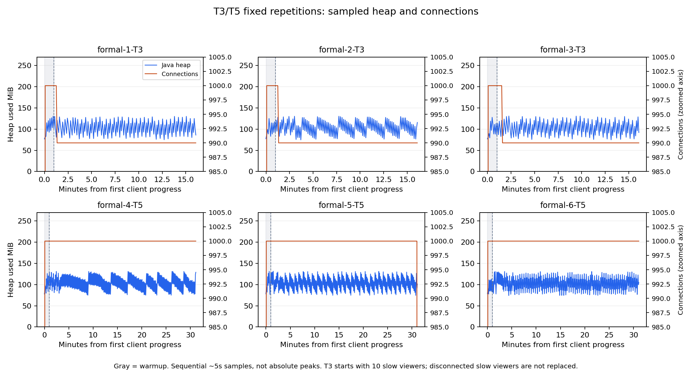

# T3/T5最终候选重复：六轮完成

2026-10-28，T3三轮、T5三轮正式测试全部通过。用户随后逐轮运行离线审计，得到6行PASS FORMAL；13:42:45又完成常规Java回归：82项、失败/错误/跳过均为0。这里记录正式结果与证据，未重新启动长测。

## 条件与结果

发布JAR SHA-256为`BC5652880AD8FA34B903B7F6350E292D090FA914C85456879243082A38F43F65`。Windows同机回环、单JVM、local/fair/buffered、8个异步提交线程，堆128～256MiB；完整输入JSON为256个UTF-8字节。每轮新JVM、预热60秒、输入20条/s，顺序执行，不并行缩短窗口，也没有正式失败后重试。

| 轮次 | 场景与测量窗口 | 正常组实收/应收 | P50/P95/P99 ms | 最大发送滞后ms | 慢组实收 | 输出丢弃/写失败 |
|---|---|---:|---|---:|---:|---|
| 1 | T3，990正常＋初始10慢读，900秒 | 17820000/17820000 | 13/24/31 | 75.28 | 590 | 1300/10 |
| 2 | T3，同上 | 17820000/17820000 | 13/23/30 | 58.33 | 1180 | 1320/0 |
| 3 | T3，同上 | 17820000/17820000 | 13/23/29 | 127.65 | 948 | 4040/9 |
| 4 | T5，1000正常，1800秒 | 36000000/36000000 | 15/28/36 | 89.25 | 0 | 0/0 |
| 5 | T5，同上 | 36000000/36000000 | 18/29/39 | 93.05 | 0 | 0/0 |
| 6 | T5，同上 | 36000000/36000000 | 17/28/37 | 88.81 | 0 | 0/0 |

T3测量期正常组累计53460000次，T5累计108000000次，合计**161460000/161460000次收齐**。预热另计：T3每轮正常1188000次，T5每轮1200000次，不混入表中测量期总数。

T3慢组每连接测量期初始潜在需求18000条，三轮都保留这10名观众的计数。直接在socket.recv前限速约1024字节/s，设置小SO_RCVBUF，继续发送心跳。三轮均形成服务端背压/降级证据，慢组被关闭后不补建，所以不是全程持续10个慢观众；整个场景也不能称零错误或所有人全收。

正常观众始终保留在分母：T3每人18000条、T5每人36000条。客户端解析真实弹幕后去重计数，最终逐观众核对；无正常组失败、缺失、重复、乱序或协议错误。所有输入含预热均接受，无限流拒绝，实际测量速率约19.99990～20.00010/s。T5每轮含预热37200000次，服务端expected/enqueued/submitted全部吻合，写失败、输出/房间丢弃均为0。

延迟抽样为每10名正常观众取1名；每轮T3有1782000个样本，T5有3600000个样本。端到端延迟从实际发送时间戳到接收回调，发送计划滞后单独记录，不相加冒称网络耗时。不平均三轮P99，表中保留各轮原值。

## 资源与清理



蓝线为Java堆使用，橙线为连接数，右轴放大为985～1005。灰色区域为预热，虚线为约略测量起点。T3从1000降到990是慢组保护退出；图末的连接下降是工具主动收尾，不能算测量中断连。

约5秒采样：测量期堆峰值约130～132MiB，曲线有回收锯齿；Java工作集峰值345～371MiB，Python工作集119～159MiB。采样端点窗口内Java平均约0.67～0.74个核，Python约0.41～0.57个核。工作集包含非堆，不能与256MiB堆上限混为一项。输出保留载荷采样峰值约0.38～0.42MiB，在途写采样最大20条；采样峰值不是绝对峰值。

全部10轮（4项前置＋6项正式）均在关闭客户端后检查12项Gauge为0，并由外层再次核对，再停止本轮自建JVM。实际PID不重复，轮次无重叠，防自动休眠句柄释放。原始计数器保留累计值，不要求所有指标归零。

## 工具与回归范围

本轮改运行工具，Java、application.yml和原始TCP负载客户端保持不变。入口记录实际运行JAR的绝对路径、哈希、PID；HTTP复用连接，单请求与总采集截止均有界；缺失清理指标保留未知并判失败。正式轮失败停止后续轮，formal-hold.json可阻止下一轮启动。

74项Python、5项指标、5项子进程、3项正式循环场景及参数覆盖检查通过，旧T3/T5证据只读复核。20连接与1000连接T3/T5四项预检通过。首批前置发现控制台轮次名被清理循环变量覆盖，结构化记录正确；先复现再修正并保留[原批记录](../longrun-repeat-01/notes.md)。修正后本批重新冻结、验收，正式六轮均一次通过，没有从旧批拼成绩。

用户最终执行的82项Java测试，包含7项WebSocketIntegrationTest，已与13份本地Surefire XML核对。记录见[最终常规回归](../final-regression/java-test-verification.json)。真实Redis集成需要独立profile，本次没有重跑；此前发布验证的1项Redis测试仍属于原发布记录。

## 证据入口

- [最终离线核对](final-verification.json)：93个冻结文件、完整源码ZIP及310个索引文件哈希吻合，27个运行相关文件与发布源码归档一致。
- [每轮结果](report.md)、[批次状态](batch-status.json)、[资源派生数据](resource-summary.json)。每轮目录包含summary、counter-delta、12项清理和原始数据索引。
- [源码归档](source-archive.json)保存ZIP实际位置与哈希；原始数据位于索引指向的.lab-artifacts目录，不能只保存摘要后删除原始证据。

只读复核，不启动服务：

```powershell
cd D:\coding\DanmakuLab
python -X utf8 docs/results/2026-10-28/longrun-repeat-02/finalize.py.txt
```

该脚本对比当前冻结工作区、源码快照及本次Surefire XML；后续代码或测试变化时应还原对应快照或保留本次核对记录，不冒充未来工作区仍完全一致。

本机结果支持指定负载下的慢连接保护、正常组完整接收及30分钟稳态，不等于最大容量或公网延迟。T4已有三对正式重复；T3/T5本次也完成三轮。Redis长期稳态、Linux/异机及用户最终演示仍分别验收。本轮未提交、推送或合并。
