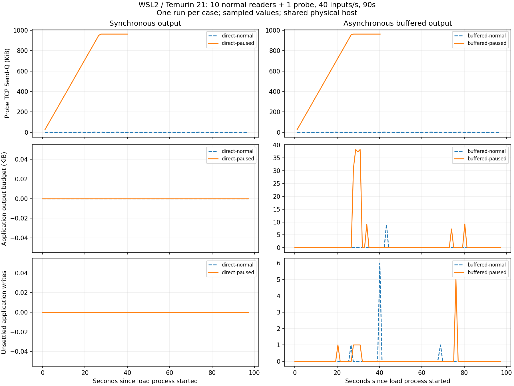

# Linux / JDK 21 慢读诊断报告

2026-10-30，北京时间。**本轮已在 WSL2 / Temurin 21 复现同步写持有房间锁的连带阻塞；
异步输出对照下，正常观众全收，慢探针按策略降级和关闭。**

## 固定条件与结果

Ubuntu 26.04 / WSL2，Temurin 21.0.12+8，Python 3.14.4；服务与客户端在同一 Linux 实例回环通信，
与 Windows 共享物理主机。每组全新 JVM，128/256 MiB 堆，local 总线、direct 房间调度、
8 个共享异步提交线程。10 名正常观众加 1 个先入房的探针，40 条输入/s、200 汉字正文、
90 秒发送加 7 秒排空，无单列预热排除。探针 SO_RCVBUF 实际为 2304 字节。

使用既有 release JAR，SHA-256：
`bc5652880ad8fa34b903b7f6350e292d090fa914c85456879243082a38f43f65`。
没有修改或重新编译 Java。JDK 来源及安装过程见[运行时记录](../linux-runtime-origin.json)。

| 输出 / 探针 | 提交输入 / accepted | 正常观众实收 / 计划需求 | 正常接收 P99 | 最大计划发送滞后 |
| --- | ---: | ---: | ---: | ---: |
| 同步 / 正常读取 | 3600 / 3600 | 36000 / 36000 | 7 ms | 15.93 ms |
| 同步 / 停止读取 | 3600 / 3449 | 34490 / 36000 | 4322 ms | 5.52 ms |
| 异步 / 正常读取 | 3600 / 3600 | 36000 / 36000 | 7 ms | 2.20 ms |
| 异步 / 停止读取 | 3600 / 3600 | 36000 / 36000 | 7 ms | 2.76 ms |

同步停读组明确拒绝 151 条，均为 `connection_rate_limit`。每名正常观众收到 3449 条，
`3449 × 10 = 34490`：计划分母差额 1510 次来自这些拒绝，现有计数没有 accepted 后正常漏收证据。
输入计划四组均完成，约 40.01 次提交/s；没有正常观众接收失败、重复或乱序。
P99 覆盖本轮所有实际收到的正常投递，包含客户端调度与发送等待，不能当服务端处理耗时。

## 怎样确认问题发生在哪里

同步停读组探针本地端口 **34276**，服务端 **18081**，JVM **2524**。可在
[原始时序](direct-paused/samples.jsonl)中按端口和 `users: java,pid=2524` 精确关联，排除 Actuator 连接。
下列秒数为采集器相对时间，指标逐项读取，不是原子快照。

1. **1.09 秒：** 探针客户端 `Recv-Q=1005`，socket 内存 `r2304/rb2304`；对应服务端 Send-Q 已为 24184 字节。
2. **26.47 秒：** 服务端 Send-Q 增至 972246 字节，`rwnd_limited=99.7%`，说明接收窗口限制了发送推进。
3. **27.52～29.72 秒：** Send-Q 约 986189 字节，accepted 固定 1056，expected 11616，submitted 11605；当前广播尚差 11 份投递。
4. **28.1 秒[线程栈](direct-paused/threads-01-28.1s.json)：** `exec-6` 在 `SocketWrapperBase.vectoredOperation`
   经 Tomcat 同步写到 `ClientConnection.writeNow` 等待，仍持有 Room `<0x00000000f326dd48>`；
   另外 9 个线程在 `DirectBroadcaster.broadcast:44` 等待这把相同的锁。

因此，本轮同时有 TCP 积压、网络写等待、同房间锁竞争和客户端长延迟的证据。
没有抓包证实零窗口报文；严谨表述为“接收缓冲满、接收窗口受限”。

异步停读组探针端口见其[客户端汇总](buffered-paused/client/summary.json)。**27.68 秒**时
Send-Q 为 986410 字节，应用输出预算 31722 字节、35 条、1 条在途写，**活跃提交线程为 0**。
这表明网络仍在等待，但没有把提交线程一直占在该等待上。采样输出预算最高 39201 字节、43 条，
28.74 秒起观察到过期淘汰；最终记录 144 次 expired 丢弃、1 次 control_expired 关闭和 1 次写失败。
关闭时还取消了 41 条排队项（`discarded{reason=connection_closed}`，可含控制回复）；
这些计数口径不同，不能直接相加当作普通弹幕漏收总数。
慢探针并未得到可靠交付保证，正常观众则收到全部 36000 次投递。

图中直发模式没有连接邮箱，相应 Gauge 为 0；断连后找不到探针 socket 的点留空。
ss 采样 Send-Q 峰值：同步停读 986190 字节，异步停读 986411 字节。
异步输出的作用是隔离等待、控制应用积压，并未消除 TCP 背压。

## 收尾、复跑与可说的结论

四组采集错误均为 0，12 项连接/队列/在途/名额 Gauge 均归零。四个 JVM 与四个客户端已退出，
18081 无监听；JAR 哈希未变，见[批次状态](batch-status.json)和[逐文件索引](evidence-sha256.json)。
同步停读有 2 次服务端写失败；两个停读组都记录了慢探针后续心跳写入失败，不能称全场景零错误。
14 项定向工具测试通过，日志见 `linux-tool-tests.txt`、`slow-consumer-tests.txt`。
正式四组使用的冻结脚本位于本目录 `tools/`；后续补充监听 PID 核验与独立进程回收，
再完成[独立 JDK21 冒烟](../linux-io-smoke-02/buffered-normal/status.json)，没有改写原四组证据。

复跑方法见[Linux 操作说明](../../../LINUX_IO.md)，原始启动命令位于各组 `commands.json`。
分析命令：`python scripts/tests/analyze_linux_io.py docs/results/2026-10-30/linux-io-01 --plot`。
分析只读取原始证据；绘图需要 matplotlib，服务运行不依赖它。

面试可以说：“我在 Linux/JDK21 用 ss 把慢探针的 TCP 积压与线程转储关联起来，定位到同步写
持有房间锁导致其他发送线程等待；在同 JAR、同负载的异步模式下，慢连接仍会降级，但正常观众全收。”

本轮每组仅一次、小规模 11 连接、单实例、回环、无独立压测机。慢探针被关闭后未补建。
只验证本轮运行路径，不是 82 项 Java 测试在 JDK21 的全量回归，也不代表千连接 Linux 容量、
公网性能或任意慢连接比例隔离。与历史 Windows/JDK25 的差值不归为代码优化收益。
